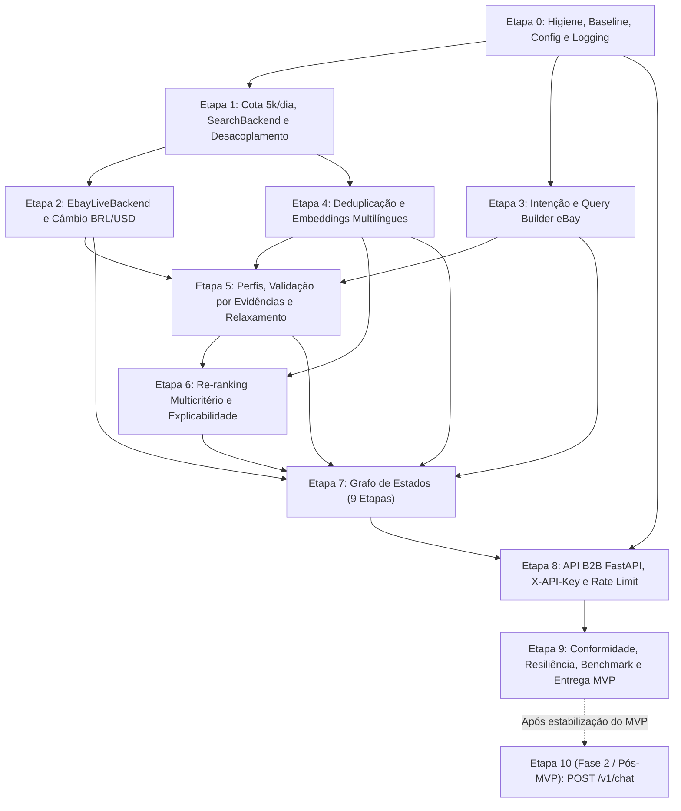

# Plano de Implementação — Backend BuscaAI (Integração Real eBay)

> **Base diagnóstica:** [`AUDITORIA.md`](AUDITORIA.md)  
> **Diretrizes de referência:** [`PROJETO_BUSCAAI_ANTIGRAVITY.md`](PROJETO_BUSCAAI_ANTIGRAVITY.md)  
> **Escopo desta fase:** 100% Backend (API B2B integrada à API real de produção da eBay, sem persistência de dados de anúncios).  
> **Status geral do plano:** `Etapas 0, 1, 2, 3 e 4 concluídas — Aguardando avaliação da Etapa 4 para iniciar a Etapa 5`

---

## 1. Visão Geral do Plano

A transformação do repositório atual (protótipo `userintent` + busca textual exaustiva em `DummyJSON` + módulo isolado do Mercado Livre + protótipo Streamlit preservado) em um **backend B2B de busca semântica e recomendação integrado à API real da eBay** está organizada em:

- **10 etapas obrigatórias de MVP (Etapa 0 a Etapa 9 — 48 tarefas)**, priorizando primeiro a higiene/conformidade, o controle de cota e a estabilidade da integração real com a eBay, seguidos pela evolução de intenção/`QueryBuilder`, motor semântico/validação/ranking/orquestração e pela API HTTP B2B (`GET /v1/health` e `POST /v1/search`).
- **1 etapa Pós-MVP / Fase 2 (Etapa 10 — 3 tarefas)** para `POST /v1/chat` multi-turno, executada após a estabilização do mecanismo de busca (conforme **D4**), utilizando ganchos extensíveis já preparados desde o MVP.

**Total:** 11 etapas (10 MVP + 1 Pós-MVP) | 51 tarefas (48 MVP + 3 Pós-MVP).

### 1.1. Resumo das Etapas

| Etapa | Fase | Título | Tarefas | Dependências diretas | Tipo de execução | Estado |
| :---: | :---: | :--- | :---: | :--- | :--- | :---: |
| **0** | MVP | Higiene, Baseline de Testes, Configuração Segura e Logging Sanitizado | 5 | Aprovação do plano; D8 aplicada em `T0.3` | Local | `Concluída` |
| **1** | MVP | Política de Cota eBay (5.000/dia), Contrato `SearchBackend` e Desacoplamento de Fontes Legadas | 4 | Etapa 0; confirmação explícita de remoção ML (`T1.3`) | Local | `Concluída` |
| **2** | MVP | Integração Real e Estável com a eBay Browse API (`EbayLiveBackend`) e Câmbio BRL/USD | 6 | Etapa 1 | Local (`T2.1`–`T2.5`) + Real controlada (`T2.6`) | `Concluída` |
| **3** | MVP | Evolução do Entendimento de Intenção e Geração de Consultas para a eBay (`EBAY_US`) | 6 | Etapa 0, Etapa 1, Etapa 2 | Local (`T3.1`–`T3.6` com mocks) | `Concluída` |
| **4** | MVP | Deduplicação Híbrida e Busca Semântica Multilíngue em Memória | 6 | Etapa 1, Etapa 3 | Local (`T4.1`–`T4.6` offline com stub/mocks + runtime plugável) | `Concluída` |
| **5** | MVP | Registro Extensível de Categorias/Perfis, Validação por Evidências e Relaxamento Controlado | 5 | Etapa 2, Etapa 3, Etapa 4 | Local | `Pendente` |
| **6** | MVP | Re-ranking Multicritério (Perfis de Prioridade) e Explicabilidade Fundamentada | 4 | Etapa 4, Etapa 5 | Local | `Pendente` |
| **7** | MVP | Orquestração por Grafo de Estados (Pipeline de 9 Etapas) | 3 | Etapa 2, Etapa 3, Etapa 4, Etapa 5, Etapa 6 (`D7` aprovada) | Local | `Pendente` |
| **8** | MVP | API HTTP B2B FastAPI (`GET /v1/health`, `POST /v1/search`), Auth `X-API-Key` e Rate Limiting | 4 | Etapa 0, Etapa 7 | Local | `Pendente` |
| **9** | MVP | Conformidade Automatizada, Resiliência, Benchmark Sintético, Validação Real e Entrega | 5 | Etapa 2 (`T2.6`), Etapa 8 | Local (`T9.1`–`T9.3`, `T9.5`) + Real controlada (`T9.4`) | `Pendente` |
| **10** | Pós-MVP (Fase 2) | Interação Conversacional Multi-turno (`POST /v1/chat`) | 3 | MVP (Etapa 9) estável e aprovado (**D4**) | Local | `Pendente (Pós-MVP)` |

### 1.2. Estado das Decisões da Equipe (`D1`–`D9`)

> **Regra:** nenhuma tarefa dependente de confirmação pendente está autorizada a ser executada antes de aprovação explícita.

| ID | Estado | Decisão / Diretriz Aplicada | Impacto no Plano |
| :-: | :---: | :--- | :--- |
| **D1** | `Aprovada` | Conta de produção eBay configurada; isenção *"Not persisting eBay data"* ativa; acesso confirmado à Browse API (`item_summary/search` e `getItem`) no `EBAY_US`; limite padrão de **5.000 chamadas diárias** (sem assumir cotas extras). | Remove bloqueios externos de `T1.1`/`T2.6`/`T9.4` e exige controle explícito de cota, tratamento de `429` e falha/indisponibilidade (`T1.1`, `T2.2`, `T2.3`). |
| **D2** | `Aprovada` | Não interromper o trabalho por investigação ou limpeza de histórico Git remoto. Manter boas práticas estritas nas novas implementações (sem segredos em código/logs/Git, uso de env vars). | Remove bloqueio de `T0.1` e reforça requisitos de sanitização em `T0.2`, `T8.3` e `T9.1`. |
| **D3** | `Aprovada` | **4 categorias MVP:** Notebooks, Smartphones, Monitores, Fones de ouvido. **6 perfis/critérios extensíveis:** melhor custo-benefício, melhor desempenho, menor preço, uso profissional, estudo, uso cotidiano. Arquitetura aberta a novas categorias/perfis sem regras rígidas espalhadas. | Define o registro declarativo da Etapa 5 (`T5.1`), o mapeamento inicial de `QueryBuilder` (`T3.3`), os perfis de pesos na Etapa 6 (`T6.1`) e os cenários do benchmark (`T9.3`, `T9.4`). |
| **D4** | `Aprovada` | MVP prioriza **`GET /v1/health`** e **`POST /v1/search`**. **`POST /v1/chat`** fica para etapa posterior (Etapa 10), após estabilização da busca, com arquitetura extensível para recebê-lo sem grandes refatorações. | `T7.1` e `T3.2` mantêm ganchos leves (`conversation_history` opcional); rotas e sessões de `POST /v1/chat` isoladas na **Etapa 10 (Pós-MVP)**. |
| **D5** | `Aprovada` | Autenticação B2B via **`X-API-Key`** (env vars), rate limiting em memória, respostas `401`/`403` e `429`, zero log de chaves e limitação multi-instância documentada. | Implementada na Etapa 8 (`T8.3`) e testada na Etapa 9 (`T9.1`, `README.md`). |
| **D6** | `Aprovada` | Taxa fixa configurável na v1 (`USD_BRL_RATE`, data de referência, origem da taxa) em componente centralizado, com preços convertidos marcados como estimativa e interface pronta para troca por provedor automático no futuro. | Define `src/buscai/pricing/currency.py` (`ExchangeRateProvider` + `FixedEnvExchangeRateProvider`) em `T2.4`. |
| **D7** | `Aprovada` | Adoção aprovada de **LangGraph** fino com `StateGraph` (estado tipado, nós modulares e testáveis), **sem checkpointer** e com **tracing desativado** (sem persistência de anúncios da eBay). | Será implementado na Etapa 7 (`T7.1`–`T7.3`) mantendo módulos de domínio Python puros. |
| **D8** | `Aprovada e aplicada na T0.3` | `UserIntent` e `PriceConstraint` com `ConfigDict(extra="ignore")`; schemas de entrada HTTP (`src/buscai/api/schemas.py`) com `extra="forbid"`; `tests/test_schema.py` atualizado. | `T0.3` concluída e testada; `extra="forbid"` será aplicado nos schemas de entrada na Etapa 8 (`T8.2`). |
| **D9** | `Aprovada` | Manter `DummyJsonCatalog` isolado apenas para testes offline (nunca em produção); **preservar `src/buscai/app/` (Streamlit) sem alterações** nesta fase; remoção de `MercadoLivreCatalog` confirmada e executada na Etapa 1 (`T1.3`). | `src/buscai/app/` intacto; `DummyJsonCatalog` isolado e Mercado Livre removido em `T1.3`–`T1.4`. |

---

### 1.3. Análise e Recomendação para D7 (LangGraph vs. Python Puro)

#### Estado real encontrado no repositório
- A orquestração atual (`src/buscai/agent/search_flow.py`) é uma função linear síncrona de 2 passos (`IntentExtractor.extract` -> `search_intent`), com 1 único desvio antecipado (`clarification_needed`).
- O fluxo-alvo completo requer **9 etapas** com **2 desvios condicionais** (saída antecipada para clarificação sem chamar eBay/embeddings; disparo de relaxamento quando há poucos candidatos válidos) e **1 ciclo limitado** (relaxamento controlado retornando à etapa de consulta à eBay).
- Além disso, **D4** exige que a arquitetura suporte a inclusão futura de `POST /v1/chat` sem grandes refatorações.

#### Avaliação comparativa

| Critério | `langgraph` fino (`StateGraph`) | Grafo tipado em Python puro |
| :--- | :--- | :--- |
| **Organização e legibilidade do ciclo** | Representa formalmente nós, arestas condicionais e ciclo limitado de relaxamento como grafo declarativo (`add_conditional_edges`). | Exige codificar máquina de estados manual (`while`/dispatcher de transições). |
| **Extensibilidade para `POST /v1/chat` (Fase 2)** | Permite evoluir o mesmo `StateGraph` (ex.: nó inicial de consolidação de turno ou roteamento) mantendo cada etapa isolada. | Possível, porém com maior acoplamento no controlador manual conforme novos desvios surgem. |
| **Complexidade e dependências** | Adiciona `langgraph` (pacote pure-Python compatível com Python 3.14; não exige instalar `langchain` nem `langchain-google-genai`). | Zero nova dependência externa. |
| **Conformidade eBay (Risco de persistência/tracing)** | **Atenção:** o ecossistema LangChain possui integração nativa com LangSmith via variáveis de ambiente (`LANGSMITH_TRACING` / `LANGCHAIN_TRACING_V2`) e suporte a `checkpointer` que, se habilitados, violariam a não persistência da seção 3. | Zero risco de tracing/checkpointer oculto por variáveis de ambiente de terceiros. |
| **Testabilidade unitária** | Nós permanecem funções Python puras e testáveis isoladamente; o grafo compilado pode ser testado em memória. | Mesmo nível de testabilidade se mantiver nós como funções puras. |

#### Recomendação fundamentada para D7
**Recomenda-se adotar `langgraph` (`StateGraph`) estritamente como camada fina de orquestração**, combinada com **3 guardrails obrigatórios**:
1. **Não acoplar os módulos de domínio ao LangGraph:** os módulos de intenção, query builder, cliente eBay, embeddings, validador, relaxamento, re-ranking e explicação serão funções/classes Python puras e independentes. O grafo apenas conecta esses nós (reduzindo o custo de eventual troca para Python puro a 1 único arquivo `graph.py`).
2. **Não instalar `langchain` / `langchain-google-genai`:** manter `IntentExtractor` nativo sobre `google-genai` (já testado e funcionando).
3. **Blindagem de conformidade no startup e nos testes:** compilar o grafo **sem checkpointer** (`graph.compile()`, nunca persistindo candidatos entre execuções), forçar/validar no startup que `LANGSMITH_TRACING` e `LANGCHAIN_TRACING_V2` estejam desativados (`false`), e cobrir essa garantia nos testes de conformidade da Etapa 9 (`T9.1`).

---

### 1.4. Investigação Técnica de D8 (`src/userintent/schema.py` e `extra="forbid"`)

#### Evidências encontradas no histórico Git e no código
1. **`commit 4c377e9` (`2026-09-23 07:58`, "first commit"):** `PriceConstraint` e `UserIntent` foram criados com `model_config = ConfigDict(extra="forbid")`, e `tests/test_schema.py` foi criado com `test_extra_fields_are_rejected()` esperando rejeição de campos desconhecidos.
2. **`commit 3b28fae` (`2026-09-23 08:08`, "fix llm model and userIntent struct"):** apenas 10 minutos depois, o mesmo autor removeu `model_config = ConfigDict(extra="forbid")` de `PriceConstraint` e `UserIntent` (simultaneamente à troca do modelo default para `gemini-3.5-flash-lite` e à remoção de `temperature=0`), mas **não atualizou** `tests/test_schema.py`, deixando o teste quebrado no repositório. *(Posteriormente, no commit `3424de6`, o import de `tests/test_schema.py` também foi alterado para `from src.userintent.schema import UserIntent`.)*

#### Verificação real no SDK instalado (`google-genai 1.75.0` — `_transformers.py:648-659`)
`IntentExtractor` (`src/userintent/llm.py:32-36`) envia `response_schema=UserIntent` à **Gemini Developer API (MLDev, `vertexai=False`)**. Inspecionando e executando a serialização real do SDK `google-genai 1.75.0` no `.venv`, observa-se:

| Configuração Pydantic (`extra=...`) | JSON Schema emitido pelo Pydantic | Comportamento no SDK `google-genai 1.75.0` (MLDev) | Comportamento ao validar resposta do Gemini |
| :--- | :--- | :--- | :--- |
| **`extra="forbid"`** | Adiciona `"additionalProperties": false` | O check client-side do SDK (`schema.get('additionalProperties')`) falha por `False` ser falsy em Python e **envia `"additionalProperties": false` no `responseSchema` HTTP** — keyword historicamente rejeitada pelo schema OpenAPI reduzido de `responseSchema` na Gemini Developer API (HTTP 400). Mesmo se aceita ou usada via `response_json_schema`, qualquer chave extra gerada pela LLM dispara `ValidationError` e quebra a requisição. | **Frágil:** pode causar rejeição de schema pela API MLDev e quebra o fluxo inteiro se a LLM retornar qualquer propriedade extra. |
| **`extra="allow"`** | Adiciona `"additionalProperties": true` | **Quebra imediatamente antes mesmo da chamada HTTP** com `ValueError: additionalProperties is not supported in the Gemini API.` em `_transformers.py:659`. | Além do erro no SDK, aceitaria campos arbitrários não tipados dentro de `UserIntent.model_extra`, contaminando o objeto de domínio. |
| **`extra="ignore"`** *(padrão do Pydantic v2)* | **Não emite** `additionalProperties` | **100% compatível** com `t_schema` e `response_schema` da Gemini Developer API. | Valida rigorosamente todos os campos conhecidos (tipos, `ge=0`, `max_price >= min_price`, `min_length=1`, `clean_list`) e **descarta silenciosamente** campos adicionais sem quebrar a busca nem poluir `UserIntent`. |

#### Recomendação para D8
1. **Manter `extra="ignore"` em `UserIntent` e `PriceConstraint`**, declarando-o **explicitamente** com `model_config = ConfigDict(extra="ignore")` e comentário explicativo documentando a incompatibilidade de `additionalProperties` com `response_schema` do Gemini e a resiliência desejada a campos extras.
2. **Usar `ConfigDict(extra="forbid")` na fronteira HTTP B2B (`src/buscai/api/schemas.py`)**, onde o consumidor externo envia JSON para `POST /v1/search` — nesse ponto, rejeitar campos desconhecidos com HTTP `422` protege integradores contra erros de digitação, sem conflitar com o Gemini.
3. **Ao executar `T0.3` (após confirmação de D8):** corrigir o import em `tests/test_schema.py` (`from userintent.schema import UserIntent`), substituir `test_extra_fields_are_rejected` por testes que garantam que:
   - campos extras são ignorados de forma segura (não aparecem em `model_dump()` nem lançam exceção);
   - o JSON Schema gerado por `google.genai._transformers.t_schema` para `UserIntent` não contém `additionalProperties` (protegendo a compatibilidade com o Gemini em regressões futuras).

---

### 1.5. Mapa de Endpoints HTTP

O repositório atual **não possui nenhum endpoint HTTP** (apenas protótipo Streamlit).

| Endpoint | Escopo | Ação | Finalidade | Observações de contrato e conformidade |
| :--- | :---: | :---: | :--- | :--- |
| `GET /v1/health` | **MVP** (Etapa 8) | **Criar** | Saúde do serviço, readiness do modelo de embedding, modo de câmbio e indicadores booleanos de configuração das credenciais | Nunca revelar valores de chaves, tokens ou detalhes internos sensíveis. |
| `POST /v1/search` | **MVP** (Etapa 8) | **Criar** | Busca pontual em texto livre (`query`, `budget_brl` opcional, `locale`, `usage_profile`/`ranking_preference` opcionais, `limit`) | Protegido por `X-API-Key` + rate limit. Retorna `status`, `results` (com `estimated_price_brl` marcado como estimativa, `score_breakdown`, `validation`, `explanation`), `applied_filters`, `relaxations`, `exchange_rate_info`, `clarification_question`, `request_id`. Resposta transitória, zero persistência/cache no servidor. |
| `POST /v1/chat` | **Pós-MVP** (Etapa 10 / D4) | **Criar na Fase 2** | Interação multi-turno com `session_id` | Sessão em memória com TTL e LRU armazenando **apenas** histórico de mensagens do usuário e `UserIntent`/critérios acumulados — **nunca** candidatos ou embeddings da eBay. |

---

## 2. Caminho Crítico, Sequência Recomendada e Preservação do Código Existente

### 2.1. Diagrama de Dependências e Caminho Crítico

### 2.2. Sequência Recomendada de Implementação

Conforme a prioridade definida pela equipe (*estabilizar primeiro a integração com a eBay e depois o endpoint de busca*):

1. **Bloco 1 — Fundação e Estabilidade da Integração eBay (`Etapa 0 -> Etapa 1 -> Etapa 2`):**
   - Limpa `stdout`, baseline de testes, configuração e logging seguro; define `SearchBackend` + orçamento de cota (5.000/dia); remove Mercado Livre e isola DummyJSON; entrega e valida `EbayLiveBackend` + OAuth em memória + `getItem` seletivo + câmbio `BRL/USD` inclusive contra a API real (`T2.6`).
2. **Bloco 2 — Inteligência Semântica, Validação e Explicabilidade (`Etapa 3` e `Etapa 4` em paralelo -> `Etapa 5` -> `Etapa 6`):**
   - Evolui `userintent` e gera queries `EBAY_US` (`Etapa 3`), escolhe e implementa embeddings multilíngues em memória (`Etapa 4`), estrutura as 4 categorias e 6 perfis/critérios com validação por evidências + relaxamento (`Etapa 5`) e re-ranking + explicações sem alucinação (`Etapa 6`).
3. **Bloco 3 — Orquestração, API B2B e Qualidade/Entrega MVP (`Etapa 7 -> Etapa 8 -> Etapa 9`):**
   - Conecta as 9 etapas no grafo de estados (`Etapa 7`), expõe `GET /v1/health` e `POST /v1/search` com `X-API-Key` e rate limit (`Etapa 8`), prova conformidade/resiliência/benchmark sintético, executa validação real nas 4 categorias MVP e atualiza `README.md` (`Etapa 9`).
4. **Bloco 4 — Pós-MVP / Fase 2 (`Etapa 10`):**
   - Após o endpoint de busca estar estável em uso real, adiciona `POST /v1/chat` com gerenciamento de sessão sem anúncios da eBay.

### 2.3. Preservação do Trabalho Existente e Compatibilidade Passiva (`D9`)

- **`src/buscai/app/` (Streamlit):** **não será editado em nenhuma tarefa do MVP.** Para evitar quebrar seus imports passivos (`from buscai.catalog.dummyjson import CatalogError, DummyJsonCatalog`, `from buscai.adapters.intent import search_intent`):
  - `CatalogError` será extraído para `src/buscai/catalog/errors.py` com **re-export compatível** em `src/buscai/catalog/dummyjson.py`.
  - `DummyJsonCatalog` permanecerá no caminho `src/buscai/catalog/dummyjson.py` (marcado claramente como legado/fixture offline, sem uso pelo novo backend), enquanto o fallback implícito `DummyJsonCatalog()` em `src/buscai/tools/products.py:97` será removido (o `agent_gateway.py` passa `DummyJsonCatalog(currency="BRL")` explicitamente, logo não quebra).
  - `src/buscai/adapters/intent.py` e `src/buscai/agent/search_flow.py` serão preservados funcionando para testes legados e para o protótipo Streamlit.
  - *Nota de conformidade registrada:* os `print("DEBUG: ...")` remanescentes dentro de `src/buscai/app/service/agent_gateway.py` permanecem intocados por D9 e **não** afetam conformidade eBay enquanto a UI estiver congelada usando DummyJSON; entretanto, caso a UI seja conectada à API real futuramente, a remoção desses `print` será obrigatória.
- **`src/userintent/`:** reaproveitado integralmente (`schema.py`, `prompt.py`, `llm.py`, `evaluator.py`, `data/intent_eval_50.jsonl`), evoluindo incrementalmente sem reescrita.

---

## 3. Detalhamento das Etapas

---

### Etapa 0 — Higiene, Baseline de Testes, Configuração Segura e Logging Sanitizado

- **Objetivo:** Eliminar vazamentos em `stdout` no núcleo de busca, estabelecer configuração centralizada e logging operacional sanitizado, extrair `CatalogError` para módulo neutro e restaurar a suíte de testes para 100% verde antes de construir novos módulos.
- **Motivação (da Auditoria):**
  - `src/buscai/tools/products.py:104` imprime `DEBUG: Página de produtos: {page}` no `stdout` (risco de vazamento em logs de servidor).
  - A suíte atual tem 2 testes falhando (`test_product_search.py` por `limit=51` vs `MAX_RESULTS_PER_PAGE=200`, e `test_schema.py` após a remoção de `extra="forbid"` em `3b28fae`), 1 script de rede solto em `tests/` (`test_search_product_no_filter_product.py`) e 2 casos com gabarito invertido em `data/intent_eval_50.jsonl` (`case_id` 6 e 43).
  - `.env.example` não documenta variáveis da eBay, câmbio nem auth B2B; `load_dotenv()` roda no import de `src/userintent/llm.py:13`; `CatalogError` está acoplado a `dummyjson.py`; `pyproject.toml` e `requirements.txt` estão desatualizados.
- **Tarefas:**
  - [x] **T0.1 — Saneamento de `stdout` em `buscai/tools` e atualização de `.env.example`** (`Concluída`):
    - Removido `print(f'\nDEBUG: Página de produtos: {page}')` de `src/buscai/tools/products.py` (preservando integralmente `src/buscai/app/` per **D9**).
    - Atualizado `.env.example` (sem valores secretos) com placeholders para `EBAY_CLIENT_ID`, `EBAY_CLIENT_SECRET`, `EBAY_MARKETPLACE_ID=EBAY_US`, `EBAY_DAILY_QUOTA_LIMIT=5000`, `USD_BRL_RATE`, `USD_BRL_RATE_UPDATED_AT`, `USD_BRL_RATE_SOURCE`, `BUSCAAI_API_KEYS`, `BUSCAAI_RATE_LIMIT_PER_MINUTE`, `BUSCAAI_LOG_LEVEL`.
  - [x] **T0.2 — Configuração centralizada (`Settings`) e logger estruturado sanitizado** (`Concluída`):
    - Criado `src/buscai/config.py` (`Settings` congelado com `SecretStr` e `load_settings()` sob demanda, eliminando `load_dotenv()` no import de `src/userintent/llm.py` e movendo `load_dotenv(override=False)` apenas para o `main()` dos scripts CLI).
    - Criado `src/buscai/observability/logging.py` (`SafeJsonFormatter`, `filter_operational_fields`, `sanitize_text`, `configure_logging`, `log_operational_event`) emitindo JSON operacional restrito a metadados permitidos e bloqueando/redigindo segredos e campos de anúncios.
  - [x] **T0.3 — Restauração da baseline de testes e correção dos 2 gabaritos do dataset** (`Concluída`):
    - Alinhado `tests/test_product_search.py` ao limite `MAX_RESULTS_PER_PAGE` (e atualizado help `"1 a 200"` em `scripts/demo_catalog_search.py` e `scripts/run_search_flow.py`).
    - Aplicada a recomendação **D8** (`ConfigDict(extra="ignore")` explícito em `PriceConstraint` e `UserIntent` em `src/userintent/schema.py`) e atualizado `tests/test_schema.py` (import corrigido, testes de descarte seguro de campos extras, validação de faixa de preço e verificação `t_schema` sem `additionalProperties`).
    - Movido `tests/test_search_product_no_filter_product.py` para `scripts/manual_search_product_no_filter.py`.
    - Corrigido `"min_inclusive": true, "max_inclusive": false` nos casos `case_id=6` e `case_id=43` em `data/intent_eval_50.jsonl`.
  - [x] **T0.4 — Extração de `CatalogError` e erros de provedor para módulo neutro** (`Concluída`):
    - Criado `src/buscai/catalog/errors.py` com `CatalogError`, `ProviderError`, `ProviderAuthError`, `ProviderRateLimitError`, `ProviderTimeoutError` e `ProviderUnavailableError`.
    - Re-exportado `CatalogError` em `src/buscai/catalog/dummyjson.py` e `src/buscai/catalog/__init__.py` e atualizados os imports em `mercadolivre.py`, `products.py`, `scripts/demo_catalog_search.py`, `tests/test_product_search.py`, `tests/test_search_flow.py` e `tests/test_catalog.py`.
  - [x] **T0.5 — Atualização de `pyproject.toml` e `requirements.txt`** (`Concluída`):
    - Atualizado `pyproject.toml` (`name = "buscai"`, pacotes `buscai` e `userintent`, dependências e extras `[dev]`/`[ui]`) e `requirements.txt`. *Ressalva:* `setuptools` não está instalado na `.venv` local para executar `pip install -e .` offline; `pyproject.toml` foi validado via `tomllib` e `pytest`.
- **Arquivos/módulos envolvidos:**
  - *Alterados:* `src/buscai/tools/products.py`, `src/buscai/catalog/dummyjson.py`, `src/buscai/catalog/__init__.py`, `src/buscai/catalog/mercadolivre.py`, `src/userintent/schema.py`, `src/userintent/llm.py`, `tests/test_catalog.py`, `tests/test_product_search.py`, `tests/test_schema.py`, `tests/test_search_flow.py`, `data/intent_eval_50.jsonl`, `.env.example`, `pyproject.toml`, `requirements.txt`, `scripts/demo_catalog_search.py`, `scripts/run_search_flow.py`, `scripts/extract_intent.py`, `scripts/run_single_intent.py`, `scripts/evaluate_intent.py`.
  - *Movido:* `tests/test_search_product_no_filter_product.py` -> `scripts/manual_search_product_no_filter.py`.
  - *Novos:* `src/buscai/config.py`, `src/buscai/observability/__init__.py`, `src/buscai/observability/logging.py`, `src/buscai/catalog/errors.py`, `tests/test_config.py`, `tests/test_logging_sanitization.py`.
  - *Intocados (D9):* `src/buscai/app/**`.
- **Dependências:** Aprovação explícita do plano; D8 aplicada em `T0.3`.
- **Critérios de aceite:**
  1. `pytest` executa com **100% de aprovação** e zero saídas `DEBUG:` de produtos no `stdout`.
  2. `Settings` carrega configuração sem `load_dotenv()` no import e sem expor credenciais em `repr()`/`str()`.
  3. Logger estruturado bloqueia ou redige qualquer tentativa de logar segredos (`EBAY_CLIENT_SECRET`, `GEMINI_API_KEY`, `X-API-Key`, tokens) ou campos proibidos de anúncios (`title`, `price`, `description`, `itemWebUrl`).
  4. `CatalogError` reside em `src/buscai/catalog/errors.py`, mantendo imports existentes funcionais.
  5. `src/buscai/app/**` permanece idêntico ao baseline.
- **Testes:**
  - Suíte completa `pytest`.
  - `tests/test_config.py` (validação de env, defaults, mascaramento).
  - `tests/test_logging_sanitization.py` (tentativa de logar tokens, API keys e campos de anúncio é sanitizada/bloqueada).
- **Riscos:**
  - Scripts CLI antigos que dependiam de `load_dotenv()` implícito no import de `llm.py` precisam chamar explicitamente o loader de configuração — validar execução dos scripts em `scripts/`.
- **Estado:** `Concluída`

#### Registro de Execução — Etapa 0 (19/11/2026)
- **Implementado:** concluídas `T0.1` a `T0.5` conforme detalhamento acima, mantendo `src/buscai/app/**` intacto (`git diff --name-only -- src/buscai/app/` vazio).
- **Decisões/ressalvas:** aplicada `ConfigDict(extra="ignore")` explícita em `UserIntent` e `PriceConstraint` (D8) de forma reversível caso a equipe solicite ajuste; `pip install -e .` não foi executado porque `setuptools` não está instalado na `.venv` offline (`pyproject.toml` validado via `tomllib` + `pytest`).
- **Evidências de verificação:**
  - `.\.venv\Scripts\python.exe -m pytest -p no:cacheprovider -v`: **86 passed, 1 warning** (depreciação externa de `google/genai/types.py` no Python 3.14) em `0.98s`.
  - Validação `tomllib` em `pyproject.toml` (`buscai 0.2.0`) e `json.loads` dos 50 casos de `data/intent_eval_50.jsonl` (`case_id` 6 e 43 com `min_inclusive=True`, `max_inclusive=False`).
  - `scripts/demo_catalog_search.py --help` e `scripts/run_search_flow.py --help` validados sem erro de import.
  - `git diff --name-only -- src/buscai/app/` retornou vazio.

---

### Etapa 1 — Política de Cota eBay (5.000/dia), Contrato `SearchBackend` e Desacoplamento de Fontes Legadas

- **Objetivo:** Implementar o controle em memória de cota da Browse API (5.000 chamadas/dia per **D1**), definir a abstração `SearchBackend` orientada a busca de marketplace, remover a integração Mercado Livre e isolar o DummyJSON exclusivamente fora do caminho de produção (preservando `src/buscai/app/` per **D9**).
- **Motivação (da Auditoria):**
  - `CatalogProvider.list_products()` + `search_products()` (`src/buscai/tools/products.py:100-128`) varre todo o catálogo até `skip >= page.total` e usa `DummyJsonCatalog()` como fallback silencioso — incompatível com a eBay e com a seção 2.
  - `Product` (`catalog/models.py`) não modela campos ricos de anúncio (`condition`, `item_web_url`, `image_url`, `seller`, `shipping`, `aspects`).
  - `MercadoLivreCatalog` existe no repositório (não conectado à busca) e precisa ser removido junto com `MERCADOLIVRE_ACCESS_TOKEN`.
- **Tarefas:**
  - [x] **T1.1 — Controle de consumo e orçamento de cota eBay em memória (`QuotaGuard`)** (`Concluída`):
    - Criado `src/buscai/search/quota.py` (`QuotaGuard`, `RequestCallBudget`, `QuotaSnapshot`) com limite padrão de **5.000 chamadas/24h** (**D1**), teto por requisição (`search` e `get_item`), aviso operacional único ao cruzar `warning_ratio` (80%) via logger sanitizado, janela deslizante em memória e documentação explícita da limitação multi-instância (**D5**).
  - [x] **T1.2 — Contratos `SearchBackend`, `SearchQuery`, `SearchResponse` e `Candidate`** (`Concluída`):
    - Criados `src/buscai/search/models.py`, `src/buscai/search/backend.py` e `src/buscai/search/__init__.py` com modelos Pydantic imutáveis (`SellerInfo`, `ShippingInfo`, `Candidate`, `SearchQuery`, `SearchResponse`) e protocolo `SearchBackend`, preservando campos ausentes como `None` e preços em `Decimal`.
  - [x] **T1.3 — Remoção completa da integração Mercado Livre** (`Concluída`):
    - Removidos `src/buscai/catalog/mercadolivre.py`, `scripts/check_mercadolivre_catalog.py`, `tests/test_mercadolivre.py` e `MERCADOLIVRE_ACCESS_TOKEN` de `.env.example`.
    - Verificada ausência total de referências a Mercado Livre em `src/`, `scripts/`, `tests/`, `.env.example`, `pyproject.toml` e `requirements.txt`.
  - [x] **T1.4 — Isolamento do DummyJSON fora do caminho de produção** (`Concluída`):
    - Removido o fallback silencioso `DummyJsonCatalog()` de `src/buscai/tools/products.py` (passando a exigir `catalog` explícito).
    - Documentado explicitamente `src/buscai/catalog/dummyjson.py` como legado/fixture offline (preservando compatibilidade passiva com `src/buscai/app/` per **D9**) e atualizados `scripts/demo_catalog_search.py` e `scripts/run_search_flow.py`.
    - Criado `tests/test_architecture_boundaries.py` validando via AST a ausência de imports de `dummyjson` em módulos de produção e a remoção completa de Mercado Livre.
- **Arquivos/módulos envolvidos:**
  - *Novos:* `src/buscai/search/__init__.py`, `src/buscai/search/quota.py`, `src/buscai/search/models.py`, `src/buscai/search/backend.py`, `tests/test_quota.py`, `tests/test_search_models.py`, `tests/test_architecture_boundaries.py`.
  - *Alterados:* `src/buscai/tools/products.py`, `src/buscai/catalog/dummyjson.py`, `.env.example`, `scripts/run_search_flow.py`, `scripts/demo_catalog_search.py`, `tests/test_product_search.py`.
  - *Removidos:* `src/buscai/catalog/mercadolivre.py`, `scripts/check_mercadolivre_catalog.py`, `tests/test_mercadolivre.py`.
  - *Intocados (D9):* `src/buscai/app/**`.
- **Dependências:** Etapa 0 concluída; confirmação explícita de remoção do Mercado Livre (`T1.3`).
- **Critérios de aceite:**
  1. `QuotaGuard` impede exceder teto por requisição e teto diário configurável (5.000/dia default).
  2. `Candidate` e `SearchQuery` validam tipos (`Decimal`, moedas ISO-3) e mantêm campos ausentes como `None`.
  3. Zero referências a Mercado Livre / `MERCADOLIVRE_ACCESS_TOKEN` no repositório ativo.
  4. `search_products` legado exige `catalog` explícito; teste de fronteira arquitetural prova zero dependência de DummyJSON nos pacotes de produção.
  5. `src/buscai/app/**` permanece intocado e suas importações legadas continuam válidas.
- **Testes:**
  - `tests/test_quota.py` (orçamento por requisição, limite diário 5.000, reset de janela 24h, thread-safety).
  - `tests/test_search_models.py` (normalização, opcionais `None`, rejeição de valores inválidos).
  - `tests/test_architecture_boundaries.py` (AST/import scan garantindo isolamento de `dummyjson` e ausência de `mercadolivre`).
  - Atualização de `tests/test_product_search.py` (garantir que `search_products(..., catalog=None)` falha explicitamente em vez de chamar DummyJSON silenciosamente).
- **Riscos:**
  - Algum script legado que chamava `search_products(q)` sem passar `catalog` falhará até receber o catálogo explícito — verificar todos os scripts em `scripts/` e testes em `tests/`.
- **Estado:** `Concluída`

#### Registro de Execução — Etapa 1 (19/11/2026)
- **Implementado:** concluídas `T1.1` a `T1.4` com criação do pacote `buscai.search` (`quota.py`, `models.py`, `backend.py`), remoção definitiva dos artefatos do Mercado Livre e isolamento do `DummyJsonCatalog` (mantendo `src/buscai/app/**` intacto per D9).
- **Decisões aplicadas:** confirmadas formalmente **D7** (`langgraph` fino com `StateGraph` sem checkpointer/tracing para Etapa 7), **D8** (`ConfigDict(extra="ignore")` em `UserIntent`/`PriceConstraint` e `extra="forbid"` reservado à entrada HTTP na Etapa 8) e remoção de Mercado Livre (`T1.3`).
- **Evidências de verificação:**
  - `.\.venv\Scripts\python.exe -m pytest -p no:cacheprovider -v`: **101 passed, 1 warning** (depreciação externa de `google/genai/types.py` no Python 3.14) em `1.04s` — incluindo `tests/test_quota.py`, `tests/test_search_models.py`, `tests/test_architecture_boundaries.py` e o novo caso em `tests/test_product_search.py`.
  - Varredura global em `src/`, `scripts/`, `tests/`, `.env.example`, `pyproject.toml` e `requirements.txt` confirmou zero referências residuais a `mercadolivre` / `MERCADOLIVRE_ACCESS_TOKEN`.
  - `git diff --name-only -- src/buscai/app/` retornou vazio.

---

### Etapa 2 — Integração Real e Estável com a eBay Browse API (`EbayLiveBackend`) e Câmbio BRL/USD

- **Objetivo:** Entregar e estabilizar a integração produtiva, resiliente e conforme com a eBay Browse API (`EbayOAuthClient` + `EbayLiveBackend` com `item_summary/search` e `getItem` seletivo no `EBAY_US`) e o componente centralizado/extensível de conversão cambial BRL ↔ USD (**D1**, **D6**).
- **Motivação (da Auditoria):**
  - Existe apenas o protótipo `scripts/check_ebay_key.py` (untracked), sem reuso de token OAuth (risco de esgotar 1.000 tokens/24h), sem timeout, sem retry para `429`/`5xx`, sem `getItem`, sem conversão BRL ↔ USD e imprimindo títulos/preços da eBay no terminal.
- **Tarefas:**
  - [x] **T2.1 — Gestor de token OAuth 2.0 `client_credentials` em memória (`EbayOAuthClient`)** (`Concluída`):
    - Criado `src/buscai/search/ebay_auth.py` (`EbayOAuthClient`) usando `httpx` contra `POST https://api.ebay.com/identity/v1/oauth2/token`, mantendo o token apenas em memória com margem de renovação de 120s, lock thread-safe (`threading.Lock`), mapeamento seguro de erros HTTP/timeout e zero exposição de credenciais/tokens em `__repr__`, exceções ou logs.
  - [x] **T2.2 — Cliente `EbayLiveBackend.search()` (`item_summary/search`) com resiliência** (`Concluída`):
    - Criado `src/buscai/search/ebay_backend.py` (`EbayLiveBackend`, `build_ebay_search_params`) consultando `item_summary/search` (`EBAY_US`), filtros `price:[..],priceCurrency:USD`, `buyingOptions:{FIXED_PRICE}` e `conditions`, integrado ao `QuotaGuard`, com renovação única em `401`, retry/backoff limitado para `429` (`Retry-After`), `5xx` e timeout, e zero cache de anúncios.
  - [x] **T2.3 — Enriquecimento seletivo via `getItem` (`GET /buy/browse/v1/item/{item_id}`)** (`Concluída`):
    - Implementados `get_item_details()` e `enrich_candidates()` com `ThreadPoolExecutor` limitado, respeitando `max_items` e `RequestCallBudget` e tolerando `404`/falha parcial sem derrubar os demais candidatos.
  - [x] **T2.4 — Normalizador defensivo eBay e componente centralizado de câmbio BRL ↔ USD (`ExchangeRateProvider`)** (`Concluída`):
    - Criado `src/buscai/search/ebay_mapper.py` (`parse_json_decimal`, `map_item_summary`, `map_item_detail`, `merge_candidate_details`, `parse_search_response`) preservando `Decimal` e campos ausentes como `None`.
    - Criado `src/buscai/pricing/currency.py` (`ExchangeRateProvider`, `FixedEnvExchangeRateProvider`, `CurrencyConverter`, `ExchangeRateInfo`, `EstimatedPriceBRL`) com `is_estimate=True`, data e origem explícitas (**D6**).
  - [x] **T2.5 — Substituição de `scripts/check_ebay_key.py` por script diagnóstico seguro** (`Concluída`):
    - Removido `scripts/check_ebay_key.py` e criado `scripts/check_ebay_connection.py` emitindo apenas metadados operacionais (zero títulos, preços, URLs, vendedores ou tokens).
  - [x] **T2.6 — Teste de integração controlada contra a API real da eBay (`EBAY_US`, opt-in)** (`Concluída — pronto para execução opt-in manual`):
    - Criado `tests/integration/test_ebay_live.py` (marker `ebay_live` registrado em `pyproject.toml`), desativado por padrão e habilitado apenas por `RUN_EBAY_INTEGRATION_TESTS=1` (consumo `<= 3` chamadas, sem gravação em disco ou vazamento em logs).
- **Arquivos/módulos envolvidos:**
  - *Novos:* `src/buscai/search/ebay_auth.py`, `src/buscai/search/ebay_backend.py`, `src/buscai/search/ebay_mapper.py`, `src/buscai/pricing/__init__.py`, `src/buscai/pricing/currency.py`, `scripts/check_ebay_connection.py`, `tests/test_ebay_auth.py`, `tests/test_ebay_backend.py`, `tests/test_currency.py`, `tests/integration/test_ebay_live.py`, `RELATORIO_TESTES_ETAPA_2.md`.
  - *Removido/substituído:* `scripts/check_ebay_key.py`.
  - *Alterados:* `src/buscai/search/__init__.py`, `pyproject.toml`.
- **Dependências:** Etapa 1 (`T1.1`, `T1.2`).
- **Critérios de aceite:**
  1. `EbayOAuthClient` reutiliza token em memória entre chamadas e renova de forma thread-safe próximo ao vencimento ou em `401`, sem vazar credenciais.
  2. `EbayLiveBackend` trata `429` (`Retry-After`), `5xx`, timeouts e `QuotaGuard`; duas chamadas consecutivas executam duas requisições HTTP distintas (zero cache de anúncios).
  3. `enrich_candidates()` respeita `max_items` e cota diária e tolera `404` parcial.
  4. `ExchangeRateProvider` centraliza toda conversão `BRL <-> USD`, sinaliza `is_estimate=True` e inclui data/origem da taxa.
  5. Testes unitários passam 100% offline via `httpx.MockTransport` com fixtures sintéticas; `test_ebay_live.py` fica isolado sob `RUN_EBAY_INTEGRATION_TESTS=1`.
- **Testes:**
  - `tests/test_ebay_auth.py` (11 casos), `tests/test_ebay_backend.py` (7 casos), `tests/test_currency.py` (17 casos) — todos offline com `httpx.MockTransport` e dados sintéticos.
  - `tests/integration/test_ebay_live.py` — opt-in controlado (`RUN_EBAY_INTEGRATION_TESTS=1`).
- **Riscos:**
  - Campos ausentes ou variações reais da resposta da eBay (`itemSummaries` / `getItem`): mitigado por parse defensivo e validável pelo usuário com o roteiro manual em `RELATORIO_TESTES_ETAPA_2.md`.
- **Estado:** `Concluída`

#### Registro de Execução — Etapa 2 (19/11/2026)
- **Implementado:** concluídas `T2.1`–`T2.6` com cliente OAuth em memória, cliente Browse API (`item_summary/search` + `getItem` seletivo), normalizador defensivo, conversão centralizada `USD/BRL` (`FixedEnvExchangeRateProvider` + `CurrencyConverter`), substituição de `scripts/check_ebay_key.py` por `scripts/check_ebay_connection.py` e suítes completas com mocks + teste real opt-in (`RUN_EBAY_INTEGRATION_TESTS=1`), mantendo `src/buscai/app/**` intocado (**D9**).
- **Auditorias e correções:** corrigidos `SyntaxWarning` na docstring de `tests/integration/test_ebay_live.py` e import não utilizado em `tests/test_ebay_backend.py`. Relatório completo registrado em [`RELATORIO_TESTES_ETAPA_2.md`](RELATORIO_TESTES_ETAPA_2.md).
- **Evidências de verificação:**
  - `.\.venv\Scripts\python.exe -m pytest -p no:cacheprovider -v`: **143 passed, 1 skipped** (`tests/integration/test_ebay_live.py` opt-in), 1 warning externo (`google/genai/types.py:42`).
  - Cobertura aproximada via `trace` (processo limpo): **1378/1533 (89.9%)** no backend (excl. `src/buscai/app/`), sendo `100.0%` em `currency.py`.
  - Checagem AST e importação de 29/29 módulos de `src/` (excl. `app/`): 0 erros; `git diff --name-only -- src/buscai/app/` vazio.

---

### Etapa 3 — Evolução do Entendimento de Intenção e Geração de Consultas para a eBay (`EBAY_US`)

- **Objetivo:** Endurecer o módulo `src/userintent/` existente para uso confiável em produção (timeouts, retries, erros tipados, `models`, `condition`, `PriceConstraint.currency`, conciliação `budget_brl` explícita, preparação para histórico multi-turno per **D4**) e construir o `QueryBuilder` gerando consultas EN-US compatíveis com a Browse API para as 4 categorias MVP (**D3**).
- **Motivação (da Auditoria):**
  - `IntentExtractor` (`src/userintent/llm.py`) não tinha timeout, retry nem tratamento de erros transitórios e tinha baixa cobertura de testes.
  - `UserIntent.query` é gerado em PT-BR, derrubando recall no `EBAY_US` (catálogo em inglês).
  - Faltava conciliar deterministicamente o `budget_brl` explícito com `UserIntent.price`, suportar `models`/`condition`/`currency` e gerar filtros oficiais para a eBay Browse API.
- **Tarefas:**
  - [x] **T3.1 — Evolução de schema/prompt e robustez do `IntentExtractor` (`src/userintent/`)** (`Concluída`):
    - Atualizado `src/userintent/schema.py` com `PriceConstraint.currency`, rejeição de `bool`/`NaN`/`inf`, `UserIntent.models` e `UserIntent.condition`, preservando `ConfigDict(extra="ignore")` (**D8**) e compatibilidade `t_schema` sem `additionalProperties`.
    - Evoluído `src/userintent/prompt.py` diferenciando estritamente `required_features`, `preferred_features`, `excluded_features`, `use_cases` (sem inventar specs), `models` e `condition`.
    - Atualizado `src/userintent/llm.py` integrando `Settings`, `HttpOptions(timeout=...)`, retry/backoff transitório (`408`/`429`/`5xx`/timeout), `IntentExtractionError`/`LLMUnavailableError`, logs sanitizados e gancho `conversation_history`.
  - [x] **T3.2 — Conciliação determinística de orçamento (`merge_explicit_budget`)** (`Concluída`):
    - Criado `src/userintent/budget.py` (`merge_explicit_budget`) com regras determinísticas e imutáveis de precedência para `budget_brl`, preservando `max_inclusive=False` em empates e rejeitando conflitos com `min_price`.
  - [x] **T3.3 — `QueryBuilder` extensível para `EBAY_US` e filtro oficial `conditionIds`** (`Concluída`):
    - Adicionado `condition_ids` numérico ASCII em `SearchQuery` (`src/buscai/search/models.py`) e emissão oficial `conditionIds:{...}` em `build_ebay_search_params` (`src/buscai/search/ebay_backend.py`).
    - Criado `src/buscai/search/query_builder.py` (`QueryBuilder`, `CategorySpec`, `DEFAULT_MVP_CATEGORIES` para **notebook, smartphone, monitor, fone de ouvido**, `AppliedBudget`, `PlannedQuery`, `SearchPlan`), traduzindo atributos objetivos PT-BR -> EN-US, convertendo BRL -> USD via `CurrencyConverter`, aplicando `conditions`/`conditionIds` oficiais, filtrando termos subjetivos/use cases para `ignored_preferences`, evitando consultas redundantes e gerando alternativa apenas quando há benefício real (zero chamadas HTTP no `QueryBuilder`).
  - [x] **T3.4 — Integração `IntentExtractor` -> `QueryBuilder` e ampliação de `test_evaluator.py`** (`Concluída`):
    - Implementado `build_search_plan_from_text` (`src/buscai/search/query_builder.py`) e reexportações em `src/buscai/search/__init__.py` e `src/userintent/__init__.py`.
    - Ampliado `tests/test_evaluator.py` (`max_inclusive=False`, clarificações, aliases, `aggregate`) e corrigido bootstrap de `sys.path` (`ROOT/src`) em `scripts/extract_intent.py` e `scripts/evaluate_intent.py`.
  - [x] **T3.5 — Suíte unitária completa da Etapa 3** (`Concluída`):
    - Atualizados `tests/test_schema.py`, `tests/test_evaluator.py`, `tests/test_search_models.py`, `tests/test_ebay_backend.py`; criados `tests/test_intent_llm.py` (6 testes) e `tests/test_query_builder.py` (7 testes, incluindo amostra das 4 categorias de `data/intent_eval_50.jsonl` e verificação AST de ausência de HTTP/LLM).
  - [x] **T3.6 — Testes de integração com mocks e auditoria geral da Etapa 3** (`Concluída`):
    - Criado `tests/test_stage3_integration.py` (7 testes) validando ponta a ponta com Gemini mockado + `httpx.MockTransport` os 6 cenários obrigatórios (notebook Lenovo, iPhone >= 256 GB, monitor 4K, fones Bluetooth ANC, smartphone até R$ 3.500, notebook bom para estudar), além de `budget_brl`, histórico, clarificação, erros, zero disco e logs limpos.
    - Executada auditoria geral completa registrada em [`RELATORIO_TESTES_ETAPA_3.md`](RELATORIO_TESTES_ETAPA_3.md).
- **Arquivos/módulos envolvidos:**
  - *Existentes alterados:* `src/userintent/__init__.py`, `src/userintent/schema.py`, `src/userintent/prompt.py`, `src/userintent/llm.py`, `src/buscai/search/__init__.py`, `src/buscai/search/models.py`, `src/buscai/search/ebay_backend.py`, `scripts/extract_intent.py`, `scripts/evaluate_intent.py`, `tests/test_schema.py`, `tests/test_evaluator.py`, `tests/test_search_models.py`, `tests/test_ebay_backend.py`.
  - *Novos:* `src/userintent/budget.py`, `src/buscai/search/query_builder.py`, `tests/test_intent_llm.py`, `tests/test_query_builder.py`, `tests/test_stage3_integration.py`, `RELATORIO_TESTES_ETAPA_3.md`.
- **Dependências:** Etapa 0 (`T0.2`, `T0.3`), Etapa 1 (`T1.2`), Etapa 2 (`T2.2`, `T2.4`).
- **Critérios de aceite:**
  1. `IntentExtractor` possui testes unitários com SDK mockado cobrindo `from_settings`, `HttpOptions` timeout, `conversation_history`, `parsed`, fallback JSON, retry transitório e falhas não transitórias.
  2. `merge_explicit_budget` aplica regras determinísticas testadas para `budget_brl`.
  3. `QueryBuilder` traduz adequadamente intenção PT-BR das 4 categorias MVP para consultas concisas EN-US + filtros oficiais eBay (`price:[..],priceCurrency:USD`, `buyingOptions:{FIXED_PRICE}`, `conditions`, `conditionIds`) sem `category_ids` inventados, sem chamadas HTTP e mantendo `<= 1` chamada LLM.
  4. Compatibilidade preservada com `scripts/evaluate_intent.py`, `src/buscai/agent/search_flow.py`, `src/buscai/adapters/intent.py` e `src/buscai/app/` (**D9**).
- **Testes:**
  - `tests/test_schema.py`, `tests/test_evaluator.py`, `tests/test_search_models.py`, `tests/test_ebay_backend.py`, `tests/test_intent_llm.py`, `tests/test_query_builder.py`, `tests/test_stage3_integration.py` + regressão completa `pytest`.
- **Riscos:**
  - Diferenças lexicais em títulos reais do `EBAY_US` quando features como armazenamento estão apenas em `localizedAspects`: mitigado com consulta alternativa sem keywords de atributo no título quando benéfico (`max_queries=2`), preparando terreno para o enriquecimento seletivo por `getItem` na **Etapa 5**.
- **Estado:** `Concluída`

#### Registro de Execução — Etapa 3 (19/11/2026)
- **Implementado:** concluídas `T3.1`–`T3.6` evoluindo `src/userintent/` e entregando `QueryBuilder` + `build_search_plan_from_text` em `src/buscai/search/query_builder.py`, com regressão 100% verde e preservação integral de `src/buscai/app/**` (**D9**).
- **Decisões técnicas e conformidade eBay:** validados na documentação oficial da eBay Browse API (`item_summary/search`) os parâmetros `price:[Min..Max],priceCurrency:USD`, `buyingOptions:{FIXED_PRICE}`, `conditions:{NEW|USED}` e `conditionIds:{1500|2000|2010|2020|2030}`; `category_ids` permanece `()` por padrão para evitar inventar IDs até futura tabela validada por API.
- **Correções durante a validação:** adicionado setup de `ROOT/src` em `sys.path` em `scripts/extract_intent.py` e `scripts/evaluate_intent.py` para execução direta na CLI; ajustados casos e asserts nos novos testes de subtipos (`tests/test_query_builder.py`) e import em `tests/test_stage3_integration.py`.
- **Evidências de verificação:**
  - `.\.venv\Scripts\python.exe -m pytest -p no:cacheprovider -v`: **168 passed, 1 skipped** (`test_ebay_live.py` opt-in), **0 failed**, 1 warning externo (`google/genai/types.py:42`).
  - Cobertura via `trace` em processo limpo (`src/` excl. `buscai/app/`): **1939 / 2135 (90.8%)** (`query_builder.py` 93.0%, `llm.py` 91.5%, `schema.py` 95.1%, `evaluator.py` 95.7%, `budget.py` 84.5%).
  - Checagem AST, importação de 31/31 módulos de `src/` (excl. `app/`), verificação de `get_type_hints` e `git diff --name-only -- src/buscai/app/` (vazio). Relatório completo em [`RELATORIO_TESTES_ETAPA_3.md`](RELATORIO_TESTES_ETAPA_3.md).

---

### Etapa 4 — Deduplicação Híbrida e Busca Semântica Multilíngue em Memória

- **Objetivo:** Implementar representação enxuta de candidatos, serviço modular de embeddings multilíngues em memória (PT-BR ↔ EN-US), deduplicação híbrida (sinais estruturados + cosseno semântico) e integração com o fluxo de busca existente, em estrita conformidade com a não persistência eBay.
- **Motivação (da Auditoria):**
  - O núcleo legado (`src/buscai/tools/products.py`) usava apenas matching léxico exato, inadequado para PT-BR ↔ EN-US.
  - O ambiente local roda **Python 3.14.7 Windows** sem `torch`/`sentence-transformers`/`fastembed` instalados; logo, a arquitetura precisa desacoplar `EmbeddingProvider`, validar trade-offs de runtime e garantir testes 100% reproduzíveis offline via provedor substituto.
  - Pela conformidade eBay, vetores derivados de anúncios devem ser estritamente transitórios na requisição.
- **Tarefas:**
  - [x] **T4.1 — Auditoria dos contratos `Candidate`/`SearchQuery`/`SearchResponse`, `Settings` e pipeline atual** (`Concluída`):
    - Mapeados os fluxos de `EbayLiveBackend`, `ebay_mapper`, `QueryBuilder` e `Settings` (`RELATORIO_TESTES_ETAPA_4.md` Seção 1), garantindo zero duplicação de contratos.
  - [x] **T4.2 — Avaliação comparativa e escolha do modelo de embeddings + benchmark sintético** (`Concluída`):
    - Comparados `intfloat/multilingual-e5-small` (escolhido padrão: 384d `float32`, 118M params, ~470 MB PyTorch / ~117–224 MB ONNX, 512 tokens, 100+ idiomas, MIT, `query:`/`passage:`), `sentence-transformers/paraphrase-multilingual-MiniLM-L12-v2` (384d, Apache-2.0, simétrico) e `BAAI/bge-m3` (569M / ~2.3 GB, descartado por footprint/latência em CPU).
    - Documentada compatibilidade em **Python 3.14.7 Windows** (disponibilizando backend `sentence_transformers` e backend leve `fastembed`/ONNX Runtime em extras opcionais do `pyproject.toml`, mais `DeterministicStubEmbeddingProvider` offline sem download).
    - Criados `data/eval_semantic_synthetic.jsonl` e `scripts/benchmark_embeddings.py`.
  - [x] **T4.3 — Representação enxuta e Serviço modular de Embeddings (`representation.py`, `embeddings.py`, `ranker.py`)** (`Concluída`):
    - Criado `src/buscai/semantic/representation.py` (`build_candidate_embedding_text` excluindo `price`, URLs, `image_url`, `seller`, `shipping`, `buying_options` e `item_id`; `extract_product_attributes` extraindo marca, modelo, MPN/UPC/EAN, armazenamento, RAM, tela, resolução, Hz, painel, conectividade, form factor e condição).
    - Criado `src/buscai/semantic/embeddings.py` (`EmbeddingService`, `SentenceTransformerEmbeddingProvider`, `FastEmbedEmbeddingProvider`, `DeterministicStubEmbeddingProvider`, `EmbeddingModelInfo`, normalização L2 `float32`, batching, lazy load thread-safe de pesos e tratamento de erros).
    - Criado `src/buscai/semantic/ranker.py` (`InMemorySemanticRanker` com scores `[0.0, 1.0]` e descarte de vetores ao término).
    - Estendido `src/buscai/config.py` e `.env.example` com configurações de embeddings e limiares de deduplicação.
  - [x] **T4.4 — Deduplicação híbrida em memória (`src/buscai/semantic/dedup.py`)** (`Concluída`):
    - Criado `ProductDeduplicator` + `DeduplicationConfig` diferenciando `probable_duplicate`, `similar_product` e `different_product`.
    - Aplicados vetos estruturais rígidos (categoria, marca, MPN, armazenamento, RAM, polegadas, resolução, Hz, painel, form factor, partes/funcional, variantes `Pro`/`Max`/`Ultra` e linhas/códigos distintos como `ThinkPad X1` vs `IdeaPad 3`), guarda de incerteza, transitividade segura e escolha do representante canônico mais completo.
  - [x] **T4.5 — Integração com o fluxo de busca (`src/buscai/semantic/pipeline.py`)** (`Concluída`):
    - Criados `merge_search_responses`, `SemanticProcessingResult` e `SemanticSearchProcessor` conectando `SearchResponse` da eBay -> extração de texto -> embedding único em lote -> similaridade -> deduplicação híbrida -> ranking semântico em memória (sem antecipar Etapas 5–10).
  - [x] **T4.6 — Testes específicos, conformidade eBay de não persistência, regressão e auditoria** (`Concluída`):
    - Criados `tests/test_semantic_representation.py`, `tests/test_semantic_embeddings.py`, `tests/test_semantic_dedup.py`, `tests/test_semantic_integration.py`, `tests/test_semantic_compliance.py` e atualizado `tests/test_config.py`.
    - Auditado e documentado em [`RELATORIO_TESTES_ETAPA_4.md`](RELATORIO_TESTES_ETAPA_4.md).
- **Arquivos/módulos envolvidos:**
  - *Novos:* `src/buscai/semantic/__init__.py`, `src/buscai/semantic/representation.py`, `src/buscai/semantic/embeddings.py`, `src/buscai/semantic/dedup.py`, `src/buscai/semantic/ranker.py`, `src/buscai/semantic/pipeline.py`, `data/eval_semantic_synthetic.jsonl`, `scripts/benchmark_embeddings.py`, `tests/test_semantic_representation.py`, `tests/test_semantic_embeddings.py`, `tests/test_semantic_dedup.py`, `tests/test_semantic_integration.py`, `tests/test_semantic_compliance.py`, `RELATORIO_TESTES_ETAPA_4.md`.
  - *Alterados:* `src/buscai/config.py`, `.env.example`, `pyproject.toml`, `tests/test_config.py`.
- **Dependências:** Etapa 1 (`T1.2`), Etapa 3 (`T3.3`).
- **Critérios de aceite:**
  1. Comparativo técnico entre modelos documentado em `IMPLEMENTACOES.md` e `RELATORIO_TESTES_ETAPA_4.md`, com alternativa sem download para CI/testes offline e extras opcionais no `pyproject.toml`.
  2. `ProductDeduplicator` agrupa anúncios do mesmo modelo e **nunca** funde variantes distintas (iPhone 128 vs 256 GB, Monitor FHD vs 4K, ThinkPad vs IdeaPad, iPhone 15 vs Pro), mesmo sob cosseno `0.99`.
  3. `InMemorySemanticRanker` e `SemanticSearchProcessor` operam exclusivamente em memória, com descarte verificado de vetores (`weakref` + `gc.collect()`), `0` gravação em disco, `0` cache entre requisições e `0` dados proibidos enviados a embeddings ou logs.
  4. Regressão 100% aprovada preservando as Etapas 0–3 e `src/buscai/app/` intacto (**D9**).
- **Testes:**
  - `tests/test_config.py`, `tests/test_semantic_representation.py`, `tests/test_semantic_embeddings.py`, `tests/test_semantic_dedup.py`, `tests/test_semantic_integration.py`, `tests/test_semantic_compliance.py` + `scripts/benchmark_embeddings.py --backend stub` + regressão completa `pytest`.
- **Riscos:**
  - *Dependência de pesos externos em Python 3.14.7 Windows:* mitigado com suporte duplo a `sentence-transformers` e `fastembed` (ONNX Runtime) em extras opcionais e execução offline via `DeterministicStubEmbeddingProvider`. Caso a equipe deseje rodar inferência neural real no Python 3.14.7 em ambiente futuro, recomenda-se validar a disponibilidade do wheel escolhido ou utilizar Python 3.12 para inferência PyTorch/ONNX.
- **Estado:** `Concluída`

#### Registro de Execução — Etapa 4 (19/11/2026)
- **Implementado:** concluídas `T4.1`–`T4.6` entregando o pacote `src/buscai/semantic/` completo (`representation.py`, `embeddings.py`, `dedup.py`, `ranker.py`, `pipeline.py`), dataset sintético, benchmark reproduzível e 5 suítes novas (incluindo conformidade `weakref`/disco/cache/logs/AST), mantendo `src/buscai/app/**` intacto (**D9**).
- **Benchmark offline (`scripts/benchmark_embeddings.py --backend stub`):** `precision_at_2=1.0`, `precision_at_3=0.6667`, `ndcg_at_3=0.9668`, `mrr=1.0`, `false_dedup_rate=0.0`, `dedup_accuracy=0.8333` (`5/6`; o par `Sony WH-1000XM5 Wireless Noise Cancelling` vs `Bluetooth ANC Over-Ear` foi conservadoramente preservado pelo stub lexical em ~0.73 < 0.75 sem gerar falsos agrupamentos). *(Execução com pesos neurais reais `sentence-transformers`/`fastembed` depende de instalação opcional e download explícito fora do escopo offline atual.)*
- **Evidências de verificação:**
  - `.\.venv\Scripts\python.exe -m pytest -p no:cacheprovider -v`: **188 passed, 1 skipped** (`test_ebay_live.py` opt-in), **0 failed**, 1 warning externo (`google/genai/types.py:42`).
  - Cobertura via `trace` em processo limpo (`src/` excl. `buscai/app/`): **2841 / 3162 (89.8%)**, sendo `ranker.py` `92.7%`, `pipeline.py` `89.3%`, `representation.py` `88.9%`, `dedup.py` `87.6%`, `embeddings.py` `85.1%`.
  - Checagem AST, importação de `37/37` módulos de `src/` (excl. `app/`), verificação de `get_type_hints`, `tomllib` em `pyproject.toml`, `git ls-files .env` vazio e `git diff --name-only -- src/buscai/app/` vazio. Relatório completo em [`RELATORIO_TESTES_ETAPA_4.md`](RELATORIO_TESTES_ETAPA_4.md).

---

### Etapa 5 — Registro Extensível de Categorias/Perfis, Validação por Evidências e Relaxamento Controlado

- **Objetivo:** Implementar um registro declarativo e extensível para as 4 categorias MVP e os 6 perfis/critérios de busca (**D3**), construir o validador por evidências (`atende` / `parcial` / `nao_atende` / `desconhecido`) integrando enriquecimento seletivo `getItem`, e implementar o relaxamento limitado e transparente.
- **Motivação (da Auditoria):**
  - `src/buscai/adapters/intent.py` hoje aborta toda a busca (`ConstraintUnavailableError`) se um único item não informar marca/descrição; não suporta perfis configuráveis, nem estado `desconhecido`, nem relaxamento de filtros.
- **Tarefas:**
  - [ ] **T5.1 — Registro extensível de Categorias MVP e Perfis de Uso / Objetivos (`D3`)** (`Pendente`):
    - Criar arquivo declarativo versionado (`src/buscai/validation/catalog_profiles.yaml` ou `.json`) + loader validado por Pydantic (`src/buscai/validation/registry.py`) estruturando de forma aberta a novas inclusões:
      - **4 categorias MVP:** `notebook`, `smartphone`, `monitor`, `fone de ouvido` (aliases PT-BR/EN-US, atributos relevantes esperados por categoria).
      - **Perfis de uso (`usage_profiles`):** `uso profissional`, `estudo`, `uso cotidiano` (plus mapeamento de sub-usos como `programação`, `jogos casuais`, `edição de vídeo`), com requisitos/preferências técnicas revisáveis (ex.: RAM, armazenamento, resolução/taxa de atualização, autonomia, cancelamento de ruído/microfone) — evitando regras hardcoded espalhadas pelo código e proibindo a LLM de inventar specs fora dos perfis.
      - **Objetivos/estratégias de busca (`search_objectives`):** `melhor custo-benefício`, `melhor desempenho`, `menor preço` (mapeados para políticas de filtro/ordenação da Etapa 6).
  - [ ] **T5.2 — Validador determinístico de restrições rígidas por candidato (sem quebrar `adapters/intent.py`)** (`Pendente`):
    - Criar `src/buscai/validation/hard_constraints.py`: reaproveitar a lógica de inclusividade (`min_inclusive`/`max_inclusive`), moeda e marca excluída de `adapters/intent.py`, mas avaliando **por candidato** (orçamento USD rígido violado -> `nao_atende`/descartado; marca excluída conhecida -> `nao_atende`/descartado; marca ausente -> `desconhecido`).
    - Preservar `src/buscai/adapters/intent.py` intacto para manter compatibilidade com os testes existentes e o protótipo Streamlit (**D9**).
  - [ ] **T5.3 — Extrator determinístico de atributos e Validador por Evidências** (`Pendente`):
    - Criar `src/buscai/validation/attribute_parser.py` e `src/buscai/validation/validator.py`:
      - Extrair atributos de `Candidate.aspects` (prioridade) e texto (`title`, `short_description`, `condition`, `brand`) de forma determinística (ex.: RAM, SSD/armazenamento, CPU/GPU, tamanho/resolução/Hz de tela, ANC/Bluetooth/microfone, 5G/NFC).
      - Gerar `ValidationReport` com `CriterionEvaluation(criterion, kind, status="atende"|"parcial"|"nao_atende"|"desconhecido", evidence: str | None, source_field: str | None)`.
      - Garantir invariante: **dado ausente = `desconhecido` e `evidence=None`**.
  - [ ] **T5.4 — Integração de enriquecimento seletivo (`getItem`) pré-validação final** (`Pendente`):
    - Após o ranking semântico (Etapa 4), identificar até top-K candidatos (ex.: `K <= 6`) que possuam critérios rígidos/de perfil em `desconhecido` e `details_loaded=False`, chamar `EbayLiveBackend.enrich_candidates()` respeitando `QuotaGuard` (5.000/dia) e revalidar com os `localizedAspects` obtidos.
  - [ ] **T5.5 — Política de relaxamento limitado e transparente** (`Pendente`):
    - Criar `src/buscai/validation/relaxation.py`: se a quantidade de candidatos válidos for menor que o mínimo configurado (ex.: `< 3`), aplicar até 1–2 relaxamentos ordenados (ex.: remover restrição de preferência da query em inglês, usar termo de categoria mais amplo, ou flexibilizar teto de preço apenas quando `is_hard_constraint=False`), **nunca** violando restrições rígidas (`is_hard_constraint=True` ou `excluded_brands`).
    - Registrar cada relaxamento em `list[RelaxationRecord(field, original, relaxed_to, reason)]` para exposição obrigatória na API.
- **Arquivos/módulos envolvidos:**
  - *Novos:* `src/buscai/validation/__init__.py`, `src/buscai/validation/catalog_profiles.json` (ou `.yaml`), `src/buscai/validation/registry.py`, `src/buscai/validation/hard_constraints.py`, `src/buscai/validation/attribute_parser.py`, `src/buscai/validation/validator.py`, `src/buscai/validation/relaxation.py`, `tests/test_validation_registry.py`, `tests/test_validator.py`, `tests/test_relaxation.py`.
  - *Preservado:* `src/buscai/adapters/intent.py`.
- **Dependências:** Etapa 2 (`T2.3`, `T2.4`), Etapa 3 (`T3.3`), Etapa 4 (`T4.3`).
- **Critérios de aceite:**
  1. Registro carrega e valida todas as 4 categorias e os 6 perfis/objetivos de **D3**; adicionar uma 5ª categoria em arquivo de configuração funciona sem alterar o código do validador.
  2. Todos os 4 estados (`atende`, `parcial`, `nao_atende`, `desconhecido`) são produzidos corretamente com `evidence` e `source_field` explícitos; ausência nunca gera `atende`.
  3. Restrições rígidas de orçamento e `excluded_brands` são aplicadas deterministicamente por código e nunca relaxadas silenciosamente.
  4. Enriquecimento seletivo só consulta `getItem` quando necessário e dentro do orçamento do `QuotaGuard`.
  5. Relaxamentos são limitados (<= 2) e integralmente registrados em `relaxations`.
- **Testes:**
  - `tests/test_validation_registry.py`, `tests/test_validator.py`, `tests/test_relaxation.py`.
- **Riscos:**
  - Variações textuais em títulos de anúncios da eBay (ex.: `"16G"` vs `"16 GB RAM"`, `"512G SSD"` vs `"1TB"`): cobrir padrões explícitos sem adivinhar casos ambíguos (na dúvida, retornar `desconhecido`).
- **Estado:** `Pendente`

---

### Etapa 6 — Re-ranking Multicritério (Perfis de Prioridade) e Explicabilidade Fundamentada

- **Objetivo:** Implementar o re-ranking multicritério parametrizado pelos objetivos de busca (**D3**: melhor custo-benefício, melhor desempenho, menor preço) sem imputar valores fictícios para campos ausentes, e gerar explicações em PT-BR estritamente fiéis às evidências recuperadas.
- **Motivação (da Auditoria):**
  - Hoje os resultados retornam sem ranking e sem nenhuma explicação (`src/buscai/agent/search_flow.py:1`).
- **Tarefas:**
  - [ ] **T6.1 — Motor de re-ranking multicritério com perfis de pesos (`Scorer`)** (`Pendente`):
    - Criar `src/buscai/ranking/scorer.py` combinando 5 sinais normalizados em `[0.0, 1.0]`:
      1. `semantic_similarity`
      2. `requirements_match` (calculado sobre `ValidationReport`, tratando `desconhecido` de forma neutra e explícita)
      3. `budget_fit` (adequação ao preço/orçamento — em `menor preço`, prioriza menor preço entre candidatos válidos; em `melhor custo-benefício`, equilibra requisitos + preço + reputação; em `melhor desempenho`, prioriza atendimento aos requisitos de performance + similaridade)
      4. `seller_reputation` (`feedback_percentage` + `feedback_score`, quando presente)
      5. `shipping_score` (frete grátis / custo relativo de envio, quando presente)
    - Definir perfis declarativos de pesos (todos somando `1.0`) alinhados a **D3**, com **redistribuição proporcional de pesos** sempre que um componente opcional estiver ausente (`available=False`) — jamais inventando valores!
  - [ ] **T6.2 — Contrato transparente `ScoreBreakdown`** (`Pendente`):
    - Expor `final_score`, `ranking_profile` e os componentes (`value`, `weight_applied`, `available`) na resposta da API, garantindo ordenação auditável sem expor parâmetros internos sensíveis.
  - [ ] **T6.3 — Gerador de explicações fundamentadas (`Explainer`)** (`Pendente`):
    - Criar `src/buscai/ranking/explainer.py` produzindo justificativa em PT-BR por produto recomendado:
      - Padrão determinístico (latência zero, 0% alucinação) construindo frases diretamente a partir das evidências do `ValidationReport`, preço convertido estimado em BRL (explicitando que é estimativa) e listando claramente o que permanece como **desconhecido** por falta de dados no anúncio.
      - Se houver opção híbrida futura com LLM, deixá-la desabilitada por padrão e sujeita à mesma guarda estrita de evidência.
  - [ ] **T6.4 — Verificador automatizado de fidelidade das explicações** (`Pendente`):
    - Criar verificador em teste/avaliação que checa cada especificação citada na explicação contra as evidências reais do `ValidationReport`/`Candidate`, garantindo **0% de afirmações sem evidência**.
- **Arquivos/módulos envolvidos:**
  - *Novos:* `src/buscai/ranking/__init__.py`, `src/buscai/ranking/scorer.py`, `src/buscai/ranking/explainer.py`, `tests/test_reranker.py`, `tests/test_explainer.py`.
- **Dependências:** Etapa 4 (`T4.3`), Etapa 5 (`T5.1`, `T5.3`).
- **Critérios de aceite:**
  1. Os 3 objetivos de prioridade (**D3**: melhor custo-benefício, melhor desempenho, menor preço) produzem ordenações distintas e coerentes com os pesos documentados.
  2. Campos ausentes (`seller=None`, `shipping=None`, sem orçamento) ficam marcados como `available=False` e não recebem valores inventados.
  3. Explicações citam apenas evidências presentes e declaram explicitamente critérios `desconhecido`.
  4. Taxa de afirmações sem evidência = 0% nos testes.
- **Testes:**
  - `tests/test_reranker.py`, `tests/test_explainer.py`.
- **Riscos:**
  - Calibração inadequada de pesos no modo `menor preço` podendo promover acessórios baratos irrelevantes — **mitigação:** exigir filtro rígido de categoria + threshold mínimo de `semantic_similarity` / `requirements_match` antes de aplicar peso de menor preço.
- **Estado:** `Pendente`

---

### Etapa 7 — Orquestração por Grafo de Estados (Pipeline de 9 Etapas)

- **Objetivo:** Conectar todas as etapas de domínio em um grafo de estados tipado (recomendação: `langgraph` fino, sujeito à confirmação final de **D7**) mantendo `src/buscai/agent/search_flow.py` legado preservado e preparando ganchos limpos para a futura Etapa 10 (`POST /v1/chat`).
- **Motivação (da Auditoria):**
  - `src/buscai/agent/search_flow.py` hoje é linear de 2 passos, sem busca eBay, deduplicação, embeddings, validação por evidência, relaxamento, re-ranking nem explicação.
- **Tarefas:**
  - [ ] **T7.1 — Definição de `SearchGraphState` e dos 9 nós puros do fluxo** (`Pendente`):
    - Criar `src/buscai/agent/state.py` e `src/buscai/agent/nodes.py` definindo estado tipado efêmero da requisição (`query`, `budget_brl`, `locale`, `usage_profile`, `ranking_preference`, `conversation_history` opcional para Fase 2, `intent`, `search_plan`, `candidates`, `validation_reports`, `relaxations`, `ranked_results`, `telemetry`).
    - Implementar os 9 nós desacoplados: (1) interpretar intenção, (2) extrair/validar filtros rígidos + perfil, (3) gerar consultas eBay, (4) consultar eBay `search`, (5) deduplicar + similaridade semântica, (6) `getItem` seletivo + validação por evidências, (7) decisão de relaxamento controlado (máx. 1–2 ciclos), (8) re-ranking multicritério, (9) gerar explicações.
  - [ ] **T7.2 — Compilação do grafo de estados com guardrails de conformidade (`D7`)** (`Pendente`, aguarda confirmação final de **D7**):
    - Criar `src/buscai/agent/graph.py`:
      - Se **D7 = LangGraph fino**: adicionar `langgraph` (sem `langchain`) e compilar `StateGraph(SearchGraphState)` **sem checkpointer** (`compile()`), garantindo que tracing (`LANGSMITH_TRACING` / `LANGCHAIN_TRACING_V2`) esteja desabilitado.
      - Se **D7 = Python puro**: implementar executor de grafo tipado equivalente sobre os mesmos 9 nós.
    - Medir latência por nó e contabilizar `ebay_calls` e `llm_calls` em `telemetry` (sem payloads).
  - [ ] **T7.3 — Fachada `SearchOrchestrator` e preservação de `search_flow.py`** (`Pendente`):
    - Criar `src/buscai/agent/orchestrator.py` (`SearchOrchestrator.run(...)`) aceitando dependências injetadas para facilitar testes de contrato, resiliência e conformidade.
    - Manter `src/buscai/agent/search_flow.py` e `tests/test_search_flow.py` preservados sem regressão (**D9**).
- **Arquivos/módulos envolvidos:**
  - *Novos:* `src/buscai/agent/state.py`, `src/buscai/agent/nodes.py`, `src/buscai/agent/graph.py`, `src/buscai/agent/orchestrator.py`, `tests/test_search_graph.py`.
  - *Preservados:* `src/buscai/agent/search_flow.py`, `src/buscai/agent/__init__.py`.
  - *Alterados (se D7 = LangGraph):* `requirements.txt`, `pyproject.toml`.
- **Dependências:** Etapas 2, 3, 4, 5 e 6; confirmação final de **D7**.
- **Critérios de aceite:**
  1. Grafo executa todos os desvios: (a) sucesso direto, (b) esclarecimento antecipado com 0 chamadas à eBay/embeddings, (c) relaxamento limitado quando há poucos candidatos, (d) retorno vazio controlado quando o relaxamento não encontra itens.
  2. Limite máximo de iterações impede qualquer loop infinito de relaxamento.
  3. Nenhum checkpointer persistente nem tracing com payloads habilitado; estado com candidatos é descartado ao retorno de `orchestrator.run()`.
  4. `tests/test_search_flow.py` legado continua passando integralmente.
- **Testes:**
  - `tests/test_search_graph.py` (fluxo completo com mocks/fakes injetados, medição de `telemetry`, teste de verificação de tracing desativado).
- **Riscos:**
  - Tracing ativado por variável de ambiente externa no host — verificar explicitamente no startup e abortar ou neutralizar com teste automatizado.
- **Estado:** `Pendente`

---

### Etapa 8 — API HTTP B2B FastAPI (`GET /v1/health`, `POST /v1/search`), Auth `X-API-Key` e Rate Limiting

- **Objetivo:** Construir a API HTTP B2B produtiva em FastAPI expondo `GET /v1/health` e `POST /v1/search` (**D4**), protegida por autenticação `X-API-Key` e rate limiting em memória (**D5**), com `request_id`, contratos estritos e tratamento de erros seguro e sem vazamentos.
- **Motivação (da Auditoria):**
  - O repositório não possui camada HTTP REST. `starlette`, `uvicorn` e `pydantic` já estão no `.venv`, faltando formalizar `fastapi`, rotas, middlewares e segurança B2B.
- **Tarefas:**
  - [ ] **T8.1 — Aplicação FastAPI, `lifespan` e `GET /v1/health`** (`Pendente`):
    - Adicionar `fastapi` às dependências e criar `src/buscai/api/app.py` com `debug=False`, `lifespan` inicializando `Settings`, `EbayOAuthClient`, `EbayLiveBackend`, `ExchangeRateProvider`, `SentenceTransformerProvider` (pesos em memória), `QuotaGuard` e `SearchOrchestrator`.
    - Implementar `GET /v1/health` retornando status geral, readiness do modelo de embeddings, modo de câmbio configurado e sinalizadores booleanos (`gemini_configured`, `ebay_configured`, `api_auth_configured`) — sem nunca expor segredos.
  - [ ] **T8.2 — Schemas HTTP B2B e endpoint `POST /v1/search`** (`Pendente`):
    - Criar `src/buscai/api/schemas.py` (`ConfigDict(extra="forbid")` na **entrada HTTP** para rejeitar parâmetros desconhecidos com `422`) e `src/buscai/api/routes/search.py`:
      - Entrada: `query` (1–500 chars), `budget_brl` (`Decimal > 0`, opcional), `locale` (default `"pt-BR"`), `usage_profile` (opcional), `ranking_preference` (opcional: `best_value`, `best_performance`, `lowest_price`), `limit` (1–20), `session_id` (opcional/ignorado ou reservado para Fase 2 com validação limpa).
      - Saída: `status` (`"ok"` | `"clarification_needed"` | `"no_results"`), `results` (itens completos com `estimated_price_brl` identificado como estimativa, `score_breakdown`, `validation`, `explanation`), `applied_filters`, `relaxations`, `clarification_question`, `exchange_rate_info`, `request_id`.
    - Executar o pipeline síncrono em threadpool (`def` síncrono no FastAPI ou `anyio.to_thread.run_sync`) para não bloquear o event loop durante embeddings/chamadas síncronas.
  - [ ] **T8.3 — Autenticação `X-API-Key` e Rate Limiting em memória (`D5`)** (`Pendente`):
    - Criar `src/buscai/api/security.py`: validar header `X-API-Key` com `hmac.compare_digest` contra conjunto de chaves de `BUSCAAI_API_KEYS` (nunca logar valores de chaves nem em erro), retornando HTTP `401` (ausente) / `403` (inválida). Definir explicitamente política para `GET /v1/health` (público apenas com status operacional booleano, sem informações sensíveis).
    - Criar `src/buscai/api/rate_limit.py`: rate limiter em memória por API key (janela configurável, ex.: req/minuto e teto diário por cliente compatível com a cota global de 5.000 chamadas/dia da eBay), retornando HTTP `429` + `Retry-After` + headers `X-RateLimit-*`, com limitação multi-instância documentada.
  - [ ] **T8.4 — Middleware `X-Request-ID`, logging operacional e exception handlers seguros** (`Pendente`):
    - Criar `src/buscai/api/middleware.py` e handlers globais: gerar/propagar `X-Request-ID`, emitir 1 log estruturado operacional por requisição (sem payloads), e mapear erros (`422`, `401`, `403`, `429`, `502`/`503` indisponibilidade eBay/Gemini, `504` timeout, `500` genérico) sem stacktrace nem variáveis locais na resposta ou nos logs.
- **Arquivos/módulos envolvidos:**
  - *Novos:* `src/buscai/api/__init__.py`, `src/buscai/api/app.py`, `src/buscai/api/schemas.py`, `src/buscai/api/dependencies.py`, `src/buscai/api/security.py`, `src/buscai/api/rate_limit.py`, `src/buscai/api/middleware.py`, `src/buscai/api/routes/__init__.py`, `src/buscai/api/routes/health.py`, `src/buscai/api/routes/search.py`, `tests/test_api_contracts.py`, `tests/test_api_security.py`.
  - *Alterados:* `requirements.txt`, `pyproject.toml`.
- **Dependências:** Etapa 0 (`T0.2`), Etapa 7 (`T7.3`).
- **Critérios de aceite:**
  1. Servidor sobe via `uvicorn buscai.api.app:app` com OpenAPI/Swagger funcional (exemplos sintéticos, zero dados da eBay).
  2. `GET /v1/health` retorna `200` com indicadores booleanos e zero exposição de credenciais.
  3. `POST /v1/search` valida entrada/saída estritamente, devolve estimativa BRL transparente e `request_id`.
  4. `X-API-Key` inválida/ausente retorna `401`/`403`; excesso retorna `429` + `Retry-After`; nenhuma chave aparece nos logs.
  5. Erros de terceiros retornam `502`/`503`/`504` padronizados sem vazar stacktrace.
- **Testes:**
  - `tests/test_api_contracts.py` (FastAPI `TestClient` com orchestrator/dependências fakes: health, search ok, clarificação, vazio, relaxamento, `422` com campo extra na entrada).
  - `tests/test_api_security.py` (auth `401`/`403`, rate limit `429`, `X-Request-ID`, ausência de vazamento de API key e stacktrace em logs/respostas).
- **Riscos:**
  - Uso incorreto de `async def` chamando funções bloqueantes de CPU/rede travaria concorrência do Uvicorn — garantir uso correto de rotas síncronas/threadpool.
- **Estado:** `Pendente`

---

### Etapa 9 — Conformidade Automatizada, Resiliência, Benchmark Sintético, Validação Real e Entrega do MVP

- **Objetivo:** Comprovar por testes automatizados a conformidade integral com a isenção *"Not persisting eBay data"*, validar resiliência sob falhas, medir qualidade e latência em benchmark sintético reproduzível cobrindo as 4 categorias e 6 perfis de **D3**, executar validação real controlada contra a eBay (`EBAY_US`) e atualizar toda a documentação.
- **Motivação (da Auditoria):**
  - Faltam testes automatizados de conformidade (disco, logs, cache), testes de resiliência ponta a ponta, benchmark do pipeline completo e atualização do `README.md` (hoje ainda documenta apenas a Etapa 1).
- **Tarefas:**
  - [ ] **T9.1 — Suíte automatizada de conformidade eBay (`tests/test_compliance_ebay.py`)** (`Pendente`):
    - Executar `POST /v1/search` com payloads sintéticos sentinela (`SENTINEL_TITLE_XYZ`, `SENTINEL_URL_XYZ`, `SENTINEL_SELLER_XYZ`, `SENTINEL_DESC_XYZ`) e comprovar automaticamente:
      1. **Zero persistência em disco:** snapshot do workspace e `tempfile.gettempdir()` antes e depois das requisições sem criação/alteração de arquivos com dados de anúncios.
      2. **Zero payloads/segredos em logs/`stdout`/`stderr`:** captura `caplog` + `capsys` em `DEBUG`/`INFO`/`ERROR` (inclusive durante falhas simuladas e erros `500`/`502`), verificando ausência de strings-sentinela, tokens OAuth, `GEMINI_API_KEY` e `X-API-Key`.
      3. **Zero cache de anúncios entre requisições:** 2 chamadas `POST /v1/search` idênticas acionam o `SearchBackend` 2 vezes e refletem alterações de preço/estoque da 2ª resposta imediatamente.
      4. **Tracing desativado:** confirmar ausência de tracing/checkpointer ativo no grafo.
  - [ ] **T9.2 — Suíte de resiliência ponta a ponta (`tests/test_resilience.py`)** (`Pendente`):
    - Cobrir via `TestClient` + fakes controlados: timeout da eBay (`504`/`503`), HTTP `429` persistente da eBay, HTTP `500`/`503` da eBay, anúncios sem imagem/frete/vendedor/descrição, resultado vazio mesmo após relaxamento (`status="no_results"`), falha parcial em `getItem`, timeout/indisponibilidade do Gemini (`503`), e bloqueio preventivo ao atingir cota diária configurada no `QuotaGuard`.
  - [ ] **T9.3 — Benchmark sintético reproduzível ponta a ponta (`D3`)** (`Pendente`):
    - Criar `data/eval_e2e_synthetic.jsonl` (100% sintético, **zero** dados reais da eBay) cobrindo todas as **4 categorias MVP** (notebooks, smartphones, monitores, fones de ouvido) e os **6 perfis/critérios** (custo-benefício, desempenho, menor preço, profissional, estudo, cotidiano), incluindo casos com campos faltantes e orçamentos em BRL.
    - Criar `scripts/evaluate_pipeline.py` medindo e exibindo: qualidade de intenção, 100% cumprimento de restrições rígidas, `Precision@K`, `Recall@K`, `NDCG@K`, `MRR`, taxa de afirmações sem evidência (meta: `0%`), latência total e por etapa (`p50`/`p95`), média/máximo de chamadas eBay e LLM por requisição, e comportamento em dados incompletos/vazios.
  - [ ] **T9.4 — Validação integrada controlada contra a API real da eBay (`EBAY_US`)** (`Pendente`):
    - Executar bateria manual controlada de consultas representativas nas 4 categorias MVP contra a API real de produção da eBay (consumo estritamente monitorado dentro do limite de 5.000/dia).
    - Verificar: funcionamento real de ponta a ponta, conversões BRL/USD como estimativa, atendimento de requisitos com `getItem` seletivo, latência e ausência total de payloads/segredos nos logs do servidor.
    - **Regra estrita:** registrar em `IMPLEMENTACOES.md` apenas métricas operacionais agregadas (status, latências, contagem de chamadas e observações qualitativas gerais) — **nunca** copiar títulos, preços, URLs ou respostas reais da eBay.
  - [ ] **T9.5 — Atualização integral do `README.md` e revisão final do MVP** (`Pendente`):
    - Atualizar `README.md` documentando: propósito B2B do BuscaAI, arquitetura e fluxo de 9 etapas, requisitos e setup seguro (`.env.example`), execução da API FastAPI (`uvicorn`), endpoints `GET /v1/health` e `POST /v1/search` com exemplos sintéticos, autenticação `X-API-Key` e rate limit, execução das suítes de testes (unitários, conformidade, resiliência, integração opt-in), benchmarks sintéticos, conformidade eBay ("Not persisting eBay data"), limitações conhecidas (taxa cambial fixa v1, rate limit/cota em memória para instância única, `EBAY_US` em inglês, UI Streamlit preservada separadamente) e roadmap Pós-MVP (`POST /v1/chat`).
- **Arquivos/módulos envolvidos:**
  - *Novos:* `tests/test_compliance_ebay.py`, `tests/test_resilience.py`, `data/eval_e2e_synthetic.jsonl`, `scripts/evaluate_pipeline.py`.
  - *Alterados:* `README.md`, `IMPLEMENTACOES.md`.
- **Dependências:** Etapa 2 (`T2.6`), Etapa 8 (`T8.1`–`T8.4`).
- **Critérios de aceite:**
  1. 100% da suíte `pytest` (unitários, fronteiras arquiteturais, contratos, segurança, resiliência, conformidade) passa sem falhas.
  2. `tests/test_compliance_ebay.py` valida ausência de persistência em disco, logs e cache entre requisições.
  3. Benchmark sintético (`scripts/evaluate_pipeline.py`) executa e comprova 100% de respeito às restrições rígidas e 0% de afirmações sem evidência.
  4. Validação real (`T9.4`) concluída nas 4 categorias MVP dentro da cota e com logs limpos.
  5. `README.md` e `.env.example` atualizados e verificados por execução limpa.
- **Testes:**
  - `pytest` completo, `scripts/evaluate_pipeline.py`, `RUN_EBAY_INTEGRATION_TESTS=1 pytest -m ebay_live` e checklist manual controlado `T9.4`.
- **Riscos:**
  - Testes de conformidade detectarem arquivos criados por bibliotecas de cache de terceiros (ex.: download de modelo na 1ª execução) — **mitigação:** pré-carregar o provider de embeddings antes do snapshot de disco no teste.
- **Estado:** `Pendente`

---

### Etapa 10 *(Pós-MVP / Fase 2 — Fora da Primeira Entrega, conforme D4)* — Interação Conversacional Multi-turno (`POST /v1/chat`)

> **Escopo:** Esta etapa só deve ser iniciada **após a entrega e estabilização do MVP (`Etapas 0–9`)**, conforme decisão **D4**. Os ganchos de extensibilidade (`conversation_history` opcional em `IntentExtractor` e `SearchGraphState`) já estarão prontos desde o MVP.

- **Objetivo:** Adicionar suporte conversacional multi-turno via `POST /v1/chat` com sessões em memória estritamente livres de dados de anúncios da eBay.
- **Motivação (da Auditoria e D4):**
  - A Seção 4.2 prevê `POST /v1/chat` para refinamento em turnos (ex.: responder a `clarification_question` ou ajustar orçamento/critério), mas **D4** determinou priorizar estabilidade da busca pontual (`POST /v1/search`) primeiro.
- **Tarefas:**
  - [ ] **T10.1 — Gerenciador de sessões conversacionais em memória (`InMemorySessionStore`)** (`Pendente — Pós-MVP`):
    - Criar `src/buscai/agent/sessions.py` com TTL configurável (ex.: 30 min), limite LRU de sessões e lock thread-safe.
    - Armazenar **exclusivamente** `session_id`, histórico de falas (`user`/`assistant`), `UserIntent` acumulado e `budget_brl` — **proibido** armazenar `Candidate`, `item_id`, preços, URLs ou respostas da eBay.
    - Documentar a limitação de sessões em memória em ambientes com múltiplos workers/instâncias.
  - [ ] **T10.2 — Rota `POST /v1/chat` integrada ao `SearchOrchestrator`** (`Pendente — Pós-MVP`):
    - Criar `src/buscai/api/routes/chat.py` e schemas em `src/buscai/api/schemas.py` (`ChatRequest(session_id opcional, message, budget_brl, locale, ...)` e `ChatResponse` com `session_id` + resultado da busca ou `clarification_question`).
    - Reaproveitar `IntentExtractor(..., conversation_history=...)`, `SearchOrchestrator` e `X-API-Key` + rate limiting já prontos no MVP.
  - [ ] **T10.3 — Testes de contrato multi-turno e conformidade de sessão** (`Pendente — Pós-MVP`):
    - Testar fluxo de 2+ turnos (pedido vago -> clarificação -> resposta do usuário -> busca refinada; refinamento de orçamento/uso após resultados) e adicionar asserção em `tests/test_compliance_ebay.py` provando ausência de strings-sentinela da eBay dentro do `InMemorySessionStore`.
- **Arquivos/módulos envolvidos:**
  - *Novos:* `src/buscai/agent/sessions.py`, `src/buscai/api/routes/chat.py`, `tests/test_sessions.py`, `tests/test_api_chat.py`.
  - *Alterados:* `src/buscai/api/app.py`, `src/buscai/api/schemas.py`, `tests/test_compliance_ebay.py`, `README.md`.
- **Dependências:** Etapa 9 concluída e aprovada; autorização da equipe para abrir a Fase 2 (**D4**).
- **Critérios de aceite:**
  1. Turno 1 com pergunta vaga retorna `session_id` + `clarification_question` com 0 chamadas à eBay; Turno 2 com o mesmo `session_id` combina o contexto e executa a busca.
  2. Expiração por TTL e eviction LRU funcionam deterministicamente.
  3. Inspeção automatizada prova que nenhum dado de anúncio da eBay é mantido na sessão entre turnos.
- **Testes:**
  - `tests/test_sessions.py`, `tests/test_api_chat.py`, ampliação de `tests/test_compliance_ebay.py`.
- **Riscos:**
  - Estado inconsistente entre processos se o Uvicorn rodar com `--workers > 1`: documentar obrigatoriedade de `1 worker` para sessões em memória (ou evolução futura para armazenamento distribuído apenas do histórico de texto/intenção, nunca de anúncios).
- **Estado:** `Pendente (Pós-MVP)`

---

## 4. Escopo Obrigatório (MVP Backend) vs. Evoluções Futuras

### 4.1. Obrigatório para considerar o MVP Backend completo (`Etapas 0–9`)

- Saneamento de logs/stdout, configuração segura, baseline de testes verde e isolamento de fontes legadas (`Etapa 0` e `Etapa 1`).
- Integração real em produção com a eBay Browse API (`item_summary/search` + `getItem` seletivo no `EBAY_US`), sem mocks em produção, com controle de cota de 5.000 chamadas/dia e tratamento de `429`/indisponibilidade (`Etapa 1` e `Etapa 2`).
- Conversão cambial centralizada e extensível BRL ↔ USD via taxa fixa configurável identificada como estimativa (`Etapa 2`).
- Remoção do Mercado Livre e isolamento do DummyJSON exclusivamente fora do caminho de produção, mantendo `src/buscai/app/` preservado sem alterações (`Etapa 1`).
- Entendimento de intenção + geração de consultas em inglês (`Etapa 3`).
- Deduplicação e reordenação semântica multilíngue em memória com comparação reproduzível de modelos (`Etapa 4`).
- Registro extensível cobrindo as **4 categorias MVP** (notebooks, smartphones, monitores, fones de ouvido) e os **6 perfis/critérios** (custo-benefício, desempenho, menor preço, profissional, estudo, cotidiano), validação por evidências (`atende`/`parcial`/`nao_atende`/`desconhecido`) e relaxamento controlado (`Etapa 5`).
- Re-ranking multicritério configurável (sem inventar valores ausentes) + explicações fundamentadas (`Etapa 6`).
- Orquestração em grafo de 9 etapas com conformidade total (`Etapa 7`).
- API HTTP B2B FastAPI com `GET /v1/health` e `POST /v1/search`, autenticação `X-API-Key`, rate limiting em memória, `X-Request-ID` e tratamento seguro de erros (`Etapa 8`).
- Testes automatizados de conformidade, resiliência, benchmark sintético, validação real nas 4 categorias e `README.md` atualizado (`Etapa 9`).

### 4.2. Evoluções Futuras / Pós-MVP (Fora da primeira entrega — NÃO implementar sem aprovação)

- **`POST /v1/chat` multi-turno:** planejado na **Etapa 10 (Fase 2)** após estabilização da busca (**D4**).
- **Front-end / adaptação da UI Streamlit (`src/buscai/app/`):** será tratado posteriormente com a equipe (exigirá remoção dos `print("DEBUG: ...")` de `agent_gateway.py` e revisão de `st.session_state` antes de consumir dados reais da eBay).
- **Provedor automático de câmbio BRL/USD:** plugável via protocolo `ExchangeRateProvider` (**D6**).
- **Banco vetorial persistente (`pgvector`/`FAISS`) ou cache distribuído de anúncios:** fora de escopo; exige nova análise jurídica/técnica de conformidade eBay (incluindo obrigações de Marketplace Account Deletion).
- **Rate limiting distribuído (Redis) e gestão multi-tenant em banco de dados** para escala horizontal multi-instância (**D5**).
- **Novas categorias além das 4 iniciais** (via inclusão no registro declarativo criado na Etapa 5) e **outras lojas/marketplaces**.
- **Checkout, lances, tokens de usuário ou acesso a contas da eBay.**

---

## 5. Definição de Conclusão do MVP Backend (Definition of Done)

O MVP do backend do **BuscaAI** só poderá ser declarado **concluído** quando **todos** os critérios abaixo forem verificados com evidência objetiva:

- [ ] Fluxo `POST /v1/search` integrado à API real de produção da eBay (`item_summary/search` + `getItem` seletivo no `EBAY_US`), sem mocks no caminho de produção e com controle da cota de 5.000 chamadas/dia.
- [ ] Funcionamento verificado nas **4 categorias MVP** (Notebooks, Smartphones, Monitores, Fones de ouvido) e nos **6 perfis/critérios** extensíveis definidos em **D3**.
- [ ] Zero dependência de `DummyJSON` ou `Mercado Livre` no caminho de produção (e `MERCADOLIVRE_ACCESS_TOKEN` removido), com `src/buscai/app/` preservado intacto.
- [ ] Conformidade estrita com *"Not persisting eBay data"* comprovada por testes automatizados (sem persistência em disco, sem payloads/tokens/API keys em logs ou `stdout`, sem cache de anúncios entre requisições, sem tracing/checkpointer persistente).
- [ ] Conversão cambial `BRL <-> USD` centralizada e sempre sinalizada como estimativa com data e origem.
- [ ] Validação determinística de orçamento rígido e validação de atributos por evidência (`atende`/`parcial`/`nao_atende`/`desconhecido`) aprovadas nos testes.
- [ ] Comparação reproduzível de modelos de embeddings multilíngues registrada e benchmark sintético E2E executado (100% cumprimento de restrições rígidas, 0% afirmações sem evidência, métricas `Precision@K` / `Recall@K` / `NDCG@K` / `MRR` / latência / contagem de chamadas registradas).
- [ ] API B2B documentada (OpenAPI), com `GET /v1/health`, `POST /v1/search`, autenticação `X-API-Key`, rate limiting em memória, `X-Request-ID` e tratamento padronizado de erros testados.
- [ ] Configuração segura verificada (`.env` ignorado pelo `.gitignore`, `.env.example` atualizado sem segredos).
- [ ] `README.md` atualizado refletindo fielmente execução, configuração, arquitetura, testes e limitações conhecidas.
- [ ] Nenhuma tarefa obrigatória (`Etapas 0–9`) pendente ou bloqueada sem resolução documentada.

---

## 6. Regras de Manutenção deste Documento

Este documento é o plano vivo de acompanhamento da implementação:

1. **Atualizar o estado de uma tarefa para `Concluída` somente após executar o trabalho e verificar seus critérios de aceite com evidência** (arquivos alterados, comandos/testes executados e resultados).
2. **Registrar um resumo sucinto** abaixo de cada etapa concluída (data, decisões tomadas, testes executados e eventuais pendências).
3. **Nunca apagar tarefas concluídas**; se uma tarefa deixar de ser necessária, marcá-la como `Cancelada` com justificativa explícita.
4. **Revisar dependências e riscos ao término de cada etapa**; se a implementação revelar nova dependência ou bloqueio, ajustar este arquivo antes de avançar para a próxima etapa.
5. **Não copiar respostas reais da eBay** nem valores secretos de `.env` nos registros de progresso deste documento.
