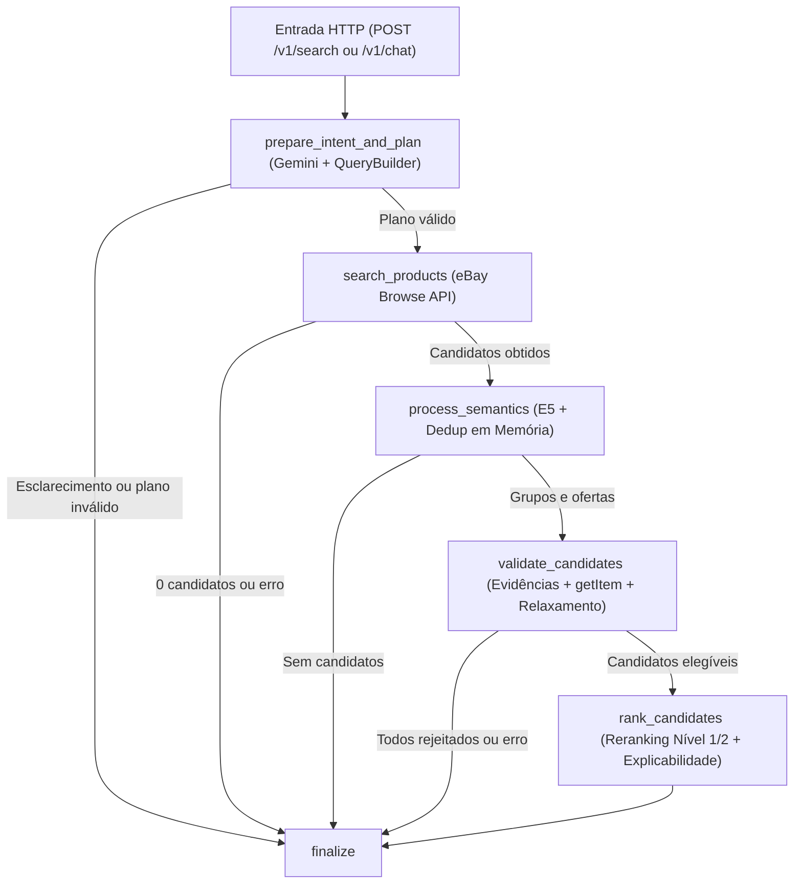

# BUSCAAI — Sistema de Busca Inteligente e Recomendação de Produtos

O **BUSCAAI** é um backend B2B de busca semântica e recomendação de produtos em marketplaces, com integração à **eBay Browse API** (`EBAY_US`).

Em vez de depender apenas de correspondência literal por palavras-chave ou ordenação simplista por menor preço, o sistema recebe consultas em linguagem natural (PT-BR), extrai a intenção estruturada via Google Gemini, planeja consultas adequadas ao catálogo da eBay, calcula similaridade semântica e deduplicação em memória com `intfloat/multilingual-e5-small`, valida candidatos por evidências concretas e ordena produtos e ofertas por **reranking multicritério com explicabilidade determinística**.

---

## Principais Funcionalidades e Arquitetura

- **Extração de intenção (`src/userintent/`):** interpretação single-turn e multi-turn em PT-BR com Google GenAI SDK (`gemini-3.5-flash-lite` configurável), schemas Pydantic (`UserIntent`, `PriceConstraint`), reconciliação determinística de dispensa/exclusão (`reconcile_negation_and_waiver`) e retries com backoff/jitter nativos.
- **Construção determinística de consultas (`QueryBuilder`):** tradução controlada de categorias, marcas, especificações e restrições de orçamento (`BRL`/`USD`) para consultas EN-US na eBay Browse API (`EBAY_US`).
- **Integração com eBay Browse API (`EbayLiveBackend`, `EbayOAuthClient`, `QuotaGuard`):** OAuth 2.0 `client_credentials` exclusivamente em memória com renovação antecipada (`120 s`), consultas a `item_summary/search` e `getItem` seletivo, backoff exponencial com respeito a `Retry-After` e controle de cota diária (`5.000` chamadas/dia por padrão).
- **Conversão estimada USD/BRL (`CurrencyConverter`):** cálculos em `Decimal` via `FixedEnvExchangeRateProvider`, sempre marcados como `is_estimate=True`.
- **Motor semântico e deduplicação em memória (`src/buscai/semantic/`):** embeddings `float32` L2-normalizados (`384` dimensões) via `SentenceTransformerEmbeddingProvider` (`intfloat/multilingual-e5-small`), deduplicação híbrida conservadora que preserva variantes e todas as ofertas distintas em `DuplicateGroup`, sem persistência em disco.
- **Validação por evidências e relaxamento (`src/buscai/validation/`):** distinção rígida entre *hard constraints* e *soft preferences*, detecção de contradições entre título e `aspects`, enriquecimento seletivo e relaxamento controlado apenas de preferências flexíveis.
- **Reranking multicritério e explicabilidade (`src/buscai/ranking/`):** ordenação em dois níveis (grupos de produtos e ofertas individuais), fator de confiança por cobertura de evidências e justificativas em PT-BR ancoradas apenas em fatos observados.
- **Orquestração stateless (`src/buscai/orchestration/`):** grafo `StateGraph` (LangGraph) compilado com `checkpointer=None` e `store=None`, bloqueando variáveis de tracing externo (`LANGSMITH_TRACING`, `LANGCHAIN_TRACING_V2`, etc.) em runtime.
- **API HTTP B2B FastAPI (`src/buscai/api/`):** endpoints `GET /v1/health`, `POST /v1/search` e `POST /v1/chat`, autenticação `X-API-Key` em tempo constante (`secrets.compare_digest`), rate limiter por cliente em memória (identificado via `HMAC-SHA256`), limite global de tamanho de corpo HTTP (`413`), cabeçalhos defensivos (`nosniff`, `DENY`, `no-referrer`, `no-store`) e logs JSON sanitizados por allowlist.



---

## Categorias MVP e Perfis de Utilização

| Categorias MVP (`catalog_profiles.json`) | Perfis de Utilização (`profile_id`) |
| :--- | :--- |
| **Notebooks** (`notebook`) | `best_value` — equilíbrio entre especificações, adequação e custo |
| **Smartphones** (`smartphone`) | `best_performance` — prioriza desempenho e especificações comprovadas |
| **Monitores** (`monitor`) | `lowest_price` — prioriza menor custo total sem assumir frete desconhecido |
| **Headphones** (`fone de ouvido`) | `professional_use` — prioriza requisitos técnicos e reputação |
| | `study` — equilibra custo, especificações e portabilidade por categoria |
| | `everyday_use` — equilíbrio prático entre condição, vendedor e custo |

---

## Versão Python e Stack de Dependências

- **Versão Python suportada:** `>= 3.11` (`pyproject.toml`).
- **Versão recomendada para produção/contêiner:** **Python `3.13`** (`python:3.13-slim`), alinhada a `[tool.mypy] python_version = "3.13"`, com suporte maduro de wheels para PyTorch, NumPy e Sentence Transformers.
- **Ambiente local de desenvolvimento validado:** Python `3.14.7` (Windows 64-bit).

| Componente | Especificação (`pyproject.toml`) | Papel |
|---|---|---|
| FastAPI + Uvicorn | `fastapi>=0.115,<1`, `uvicorn>=0.34,<1` | Camada HTTP REST B2B |
| Pydantic | `pydantic>=2.10,<3` | Schemas imutáveis (`extra="forbid"`) e `Settings` |
| LangGraph | `langgraph>=1.2,<2` | Orquestração `StateGraph` sem persistência |
| Google GenAI SDK | `google-genai>=1.0,<2` | Extração estruturada de intenção |
| HTTPX | `httpx>=0.28,<1` | Cliente HTTP para eBay OAuth e Browse API |
| NumPy | `numpy>=2,<3` | Similaridade de cosseno e normalização L2 em memória |
| Python-dotenv | `python-dotenv>=1.0,<2` | Suporte opcional a `.env` local |
| Extra `[semantic]` | `sentence-transformers>=3,<6` | Execução local real de `intfloat/multilingual-e5-small` |
| Extra `[dev]` | `pytest`, `pytest-cov`, `ruff`, `mypy` | Testes, cobertura e análise estática |

---

## Pré-requisitos

- **Python `>= 3.11`** (recomendado **Python `3.13`** em produção).
- **Memória RAM:** recomendado **`>= 4 GB` por réplica** (o modelo `intfloat/multilingual-e5-small` via PyTorch consome cerca de `1.3–1.6 GB` RSS em memória).
- **Credenciais externas:** chave ativa da **Google Gemini API** (`GEMINI_API_KEY`) e credenciais OAuth de produção da **eBay Browse API** (`EBAY_CLIENT_ID`, `EBAY_CLIENT_SECRET`).
- **Chaves B2B da API:** defina uma ou mais chaves próprias em `BUSCAAI_API_KEYS` (valores placeholder são recusados).

## Instalação e Execução Local

### 1. Criar ambiente virtual e instalar dependências

**Windows PowerShell:**
```powershell
python -m venv .venv
.\.venv\Scripts\Activate.ps1
python -m pip install -U pip
pip install -e ".[dev,semantic]"
```

**Para instalação reproduzível de produção (com hashes SHA-256):**
```bash
pip install --require-hashes --no-deps -r requirements.lock
pip install --no-deps --no-build-isolation .
```

### 2. Configurar variáveis de ambiente (local)

Copie `.env.example` para `.env` e preencha suas credenciais localmente (nunca versione `.env`):
```powershell
Copy-Item .env.example .env
```

### 3. Pré-carregar e verificar o modelo E5 localmente

```powershell
python scripts/preload_embedding_model.py
```

Para validar usando somente cache local já baixado:
```powershell
$env:BUSCAAI_EMBEDDING_LOCAL_FILES_ONLY = "true"
python scripts/preload_embedding_model.py
```

### 4. Iniciar a API localmente

```powershell
$env:PYTHONPATH = "src"
uvicorn buscai.api.app:app --host 127.0.0.1 --port 8000 --workers 1
```

- **Swagger UI:** `http://127.0.0.1:8000/docs`
- **OpenAPI JSON:** `http://127.0.0.1:8000/openapi.json`

---

## Execução em Contêiner (Docker)

O projeto fornece [`Dockerfile`](Dockerfile), [`.dockerignore`](.dockerignore) e [`.env.production.example`](.env.production.example) preparados para implantação reproduzível:

- Base **`python:3.13-slim`** com usuário não privilegiado (`appuser`).
- Dependências instaladas via `requirements.lock` (`--require-hashes --no-deps`).
- Pré-download dos pesos `intfloat/multilingual-e5-small` durante o `docker build` em `/opt/buscai/model_cache` (sem incluir segredos ou `.env` na imagem).
- Execução em **`--workers 1`** com `BUSCAAI_EMBEDDING_PRELOAD=true` e `BUSCAAI_EMBEDDING_LOCAL_FILES_ONLY=true`.

```bash
# Construir imagem (sem segredos)
docker build -t buscai-api:latest .

# Executar localmente injetando variáveis em runtime via gestor de segredos ou --env-file privado
docker run --rm -p 8000:8000 --memory=4g --cpus=4 --env-file .env.production.local buscai-api:latest
```

---

## Variáveis de Ambiente

| Variável | Obrigatória | Padrão | Descrição |
|---|---|---|---|
| `GEMINI_API_KEY` | **Sim** | — | Chave da API Google Gemini (placeholders rejeitados) |
| `GEMINI_MODEL` | Não | `gemini-3.5-flash-lite` | Modelo Gemini para extração de `UserIntent` |
| `EBAY_CLIENT_ID` | **Sim** | — | Client ID OAuth da eBay Browse API (`EBAY_US`) |
| `EBAY_CLIENT_SECRET` | **Sim** | — | Client Secret OAuth da eBay Browse API |
| `EBAY_MARKETPLACE_ID` | Não | `EBAY_US` | Marketplace alvo da eBay |
| `EBAY_DAILY_QUOTA_LIMIT` | Não | `5000` | Limite diário local ao processo para chamadas eBay |
| `BUSCAAI_API_KEYS` | **Sim** | — | Chaves B2B separadas por vírgula (`X-API-Key`; placeholders rejeitados) |
| `USD_BRL_RATE` | Não *(rec.)* | `5.50` | Taxa fixa estimada USD -> BRL (`is_estimate=True`) |
| `USD_BRL_RATE_UPDATED_AT` | Não *(rec.)* | `unknown` | Data/identificador de atualização da taxa cambial |
| `USD_BRL_RATE_SOURCE` | Não | `env_fixed_rate` | Fonte declarada da taxa cambial |
| `BUSCAAI_EMBEDDING_MODEL` | Não | `intfloat/multilingual-e5-small` | Modelo HuggingFace de embeddings |
| `BUSCAAI_EMBEDDING_BACKEND` | Não | `sentence_transformers` | Backend (`sentence_transformers` ou `fastembed`) |
| `BUSCAAI_EMBEDDING_BATCH_SIZE` | Não | `32` | Tamanho de lote (`1..256`) |
| `BUSCAAI_EMBEDDING_PRELOAD` | Não *(prod=`true`)* | `false` | Pré-carrega pesos no startup |
| `BUSCAAI_EMBEDDING_LOCAL_FILES_ONLY` | Não *(prod=`true`)* | `false` | Exige cache local sem rede ao HuggingFace Hub |
| `BUSCAAI_EMBEDDING_CACHE_DIR` | Não | `None` | Diretório explícito de cache de modelos |
| `BUSCAAI_DEDUP_PROBABLE_THRESHOLD` | Não | `0.86` | Limiar superior de similaridade na deduplicação |
| `BUSCAAI_DEDUP_SIMILAR_THRESHOLD` | Não | `0.68` | Limiar inferior de similaridade na deduplicação |
| `BUSCAAI_MAX_REQUEST_BODY_BYTES` | Não | `65536` | Limite máximo de corpo HTTP em bytes (`1024..1048576`) |
| `BUSCAAI_RATE_LIMIT_PER_MINUTE` | Não | `30` | Limite de requisições por cliente por janela |
| `BUSCAAI_RATE_LIMIT_WINDOW_SECONDS` | Não | `60` | Duração da janela deslizante em segundos |
| `BUSCAAI_SEARCH_DEFAULT_LIMIT` | Não | `10` | Limite padrão de grupos retornados (`1..50`) |
| `BUSCAAI_SEARCH_MAX_LIMIT` | Não | `20` | Limite máximo de grupos retornados (`1..50`) |
| `BUSCAAI_CHAT_MAX_HISTORY_MESSAGES` | Não | `12` | Máximo de turnos no histórico do `/v1/chat` |
| `BUSCAAI_CHAT_MAX_MESSAGE_CHARS` | Não | `500` | Limite de caracteres por mensagem |
| `BUSCAAI_CHAT_MAX_HISTORY_TOTAL_CHARS` | Não | `4000` | Limite total de caracteres do histórico |
| `BUSCAAI_LOG_LEVEL` | Não | `INFO` | `DEBUG`, `INFO`, `WARNING`, `ERROR` ou `CRITICAL` |

---

## Endpoints Principais e Autenticação

- **Autenticação B2B (`X-API-Key`):** os endpoints `POST /v1/search` e `POST /v1/chat` exigem o header `X-API-Key` válido (comparação em tempo constante via `secrets.compare_digest` contra `BUSCAAI_API_KEYS`).
- **Rate Limiting e Proteção de Payload:** controle por cliente em memória (identificado via `HMAC-SHA256`), retornando **HTTP `429`** com `Retry-After` ao exceder `BUSCAAI_RATE_LIMIT_PER_MINUTE`, e **HTTP `413`** (`payload_too_large`) ao exceder `BUSCAAI_MAX_REQUEST_BODY_BYTES`.
- **`GET /v1/health`:** endpoint público de *liveness* e *readiness*.
- **`POST /v1/search`:** busca estruturada por consulta em linguagem natural, orçamento opcional em `BRL`, filtro por `profile_id` e limite de grupos.
- **`POST /v1/chat`:** busca conversacional multi-turn com histórico sanitizado do usuário/assistente (sem retenção em disco nem envio de listagens eBay no contexto).
- **Coleção Postman:** [`postman/BUSCAAI.postman_collection.json`](postman/BUSCAAI.postman_collection.json).

---

## Health Check e Readiness (`GET /v1/health`)

- **Liveness:** sempre retorna `"liveness": "alive"` enquanto o processo HTTP responde.
- **Readiness:** verifica os 4 componentes obrigatórios (`api_auth`, `search_orchestrator`, `embeddings`, `tracing_policy`) e 1 opcional (`exchange_rate`), sem executar chamadas externas nem downloads:
  - Retorna **HTTP `200`** (`readiness: "ready"`) apenas quando chaves válidas estão configuradas, o modelo de embeddings está carregado em memória e variáveis de tracing externo estão desativadas.
  - Retorna **HTTP `503`** (`readiness: "not_ready"`) se faltar alguma credencial obrigatória, se houver placeholders ou se o modelo de embeddings ainda não estiver carregado.

---

## Testes e Qualidade

```powershell
# Suíte offline completa (sem chamadas externas nem modelo pesado)
pytest -p no:cacheprovider -m "not ebay_live and not semantic_real" -q

# Testes com o modelo real intfloat/multilingual-e5-small (cache local)
pytest -p no:cacheprovider -v -m semantic_real

# Análise estática e integridade do ambiente
ruff check --no-cache src tests scripts
mypy src
pip check
```

> Os testes contra APIs externas (`-m gemini_live` e `-m ebay_live`) são **opt-in** e ficam desativados por padrão (exigem `RUN_GEMINI_INTEGRATION_TESTS=1` ou `RUN_EBAY_INTEGRATION_TESTS=1`).

*(Consulte [`RUNBOOK_OPERACIONAL.md`](RUNBOOK_OPERACIONAL.md) para procedimentos de operação, rotação de chaves, diagnóstico de memória e recuperação de incidentes.)*

---

## Limitações Operacionais e de Escalabilidade Horizontal

1. **Consumo de memória por worker (~`1.5–1.6 GB` RSS):** cada processo que carrega `intfloat/multilingual-e5-small` via `torch` consome cerca de `1.2–1.3 GB` adicionais de RAM (`>= 4 GB RAM` recomendados por réplica com `--workers 1`).
2. **Contenção de CPU em alta concorrência (CPU-only):** em ambiente exclusivamente CPU, múltiplas requisições simultâneas concorrem pelo paralelismo interno do PyTorch na inferência E5; recomenda-se calibrar `OMP_NUM_THREADS` e `TORCH_NUM_THREADS` no hardware alvo.
3. **Estado local ao processo (`InMemoryRateLimiter` e `QuotaGuard`):** por restrição arquitetural (sem Redis ou banco de dados), contadores de rate limit e cota diária eBay não são compartilhados entre múltiplas réplicas; em deploys com mais de 1 réplica, o limite `EBAY_DAILY_QUOTA_LIMIT` deve ser dividido entre as réplicas.
4. **Câmbio USD/BRL manual:** a taxa configurada em `USD_BRL_RATE` é fixa por variável de ambiente e exige atualização operacional periódica.
5. **Observabilidade por logs JSON:** a aplicação emite logs estruturados em `stdout`, sem endpoint nativo `/metrics` (Prometheus); métricas agregadas devem ser extraídas no coletor de logs da infraestrutura.
