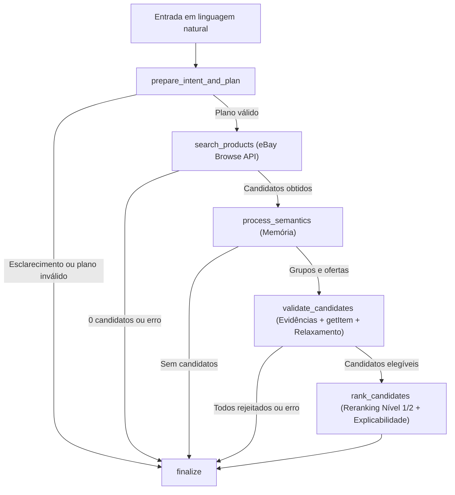

# BUSCAAI — Sistema de Busca Inteligente e Recomendação de Produtos

O **BUSCAAI** é um projeto acadêmico de Engenharia de Software e Inteligência Artificial voltado à busca inteligente e recomendação de produtos em marketplaces, com integração à **eBay Browse API** (`EBAY_US`).

Em vez de depender apenas de correspondência literal por palavras-chave ou ordenação simplista por menor preço, o sistema recebe uma consulta em linguagem natural (PT-BR), extrai a intenção estruturada do usuário, planeja consultas adequadas ao catálogo da eBay, processa similaridade semântica e deduplicação em memória, valida cada candidato por evidências concretas e ordena produtos e ofertas por meio de **reranking multicritério com explicabilidade determinística**.

> **Estado do projeto:** backend modular implementado e validado offline das **Etapas 0 a 7** (`294` testes offline aprovados; `1` teste `ebay_live` opt-in desmarcado). Trata-se de um projeto em desenvolvimento acadêmico — a camada HTTP em FastAPI (**Etapa 8**) está autorizada, mas **ainda não foi implementada**.

---

## Principais funcionalidades implementadas (Etapas 0–7)

- **Extração de intenção (`src/userintent/`):** interpretação de solicitações em linguagem natural com Google GenAI SDK (`gemini-3.5-flash-lite` configurável) e schemas Pydantic (`UserIntent`, `PriceConstraint`), reconciliando orçamentos explícitos em `BRL`/`USD`.
- **Construção determinística de consultas (`QueryBuilder`):** tradução controlada de categorias, marcas, especificações e restrições de preço para consultas estruturadas na eBay Browse API (`EBAY_US`), evitando vazamento de termos livres em português para o parâmetro `q`.
- **Integração com eBay Browse API (`EbayLiveBackend` e `EbayOAuthClient`):** consultas a `item_summary/search` e `getItem`, autenticação OAuth 2.0 em memória com renovação antecipada, retries com backoff exponencial (`tenacity`), respeito a `Retry-After` e controle de cota (`QuotaGuard` e `RequestCallBudget` para o limite padrão de `5.000` chamadas/dia).
- **Conversão estimada USD/BRL (`CurrencyConverter`):** cálculos financeiros com `Decimal` e provedor configurável (`FixedEnvExchangeRateProvider`), identificando explicitamente conversões como estimativas.
- **Processamento semântico e deduplicação (`src/buscai/semantic/`):** arquitetura baseada em `intfloat/multilingual-e5-small` (com `SentenceTransformers` / `FastEmbed` opcionais e `DeterministicStubEmbeddingProvider` para testes offline), deduplicação híbrida conservadora que não funde variantes (`mini`, `+`, `Pro/Max/Ultra`, condições distintas) e preservação de todas as ofertas distintas em `DuplicateGroup`.
- **Registro declarativo e validação por evidências (`src/buscai/catalog_profiles.json`, `src/buscai/validation/`):** separação rigorosa entre critérios obrigatórios (*hard constraints*) e preferências flexíveis (*soft preferences*), detecção de contradições internas entre título e atributos, enriquecimento seletivo via `getItem` e relaxamento controlado de preferências sem violar restrições rígidas.
- **Reranking multicritério e explicabilidade (`src/buscai/ranking/`):** ordenação em dois níveis (grupos de produtos e ofertas individuais preservadas), normalização sem coerção de dados ausentes para zero, fator de confiança por cobertura de evidências, penalidade por contradições e explicações determinísticas em PT-BR ancoradas apenas em evidências verificadas.
- **Orquestração com LangGraph (`src/buscai/orchestration/`):** grafo de estados fino (`StateGraph` com `SearchGraphState` e `SearchOrchestrator`) conectando as etapas de ponta a ponta com rotas condicionais de saída antecipada, sem checkpointer e sem tracing externo.

---

## Categorias MVP e perfis de utilização

| Categorias MVP (`catalog_profiles.json`) | Perfis de utilização disponíveis |
| :--- | :--- |
| **Notebooks** (`notebook`) | **Best Value** (`best_value`) — equilíbrio entre specs, adequação e custo |
| **Smartphones** (`smartphone`) | **Best Performance** (`best_performance`) — prioriza desempenho e specs comprovadas |
| **Monitores** (`monitor`) | **Lowest Price** (`lowest_price`) — prioriza menor custo sem assumir frete desconhecido |
| **Headphones** (`fone de ouvido`) | **Professional Use** (`professional_use`) — prioriza requisitos técnicos e reputação |
| | **Study** (`study`) — equilibra custo, especificações e portabilidade por categoria |
| | **Everyday Use** (`everyday_use`) — equilíbrio prático entre condição, vendedor e custo |

Os perfis ajustam tanto os critérios obrigatórios/flexíveis na validação (`ValidationPipeline`) quanto os pesos e regras de normalização no reranking (`WeightRegistry`).

---

## Como o sistema funciona

1. **Entrada em linguagem natural:** o usuário informa o produto desejado, orçamento e preferências em PT-BR.
2. **Intenção e plano de busca:** `IntentExtractor` gera `UserIntent` e `QueryBuilder` constrói o `SearchPlan` (ou sinaliza necessidade de esclarecimento).
3. **Consulta ao catálogo:** `SearchBackend` consulta a eBay Browse API respeitando `QuotaGuard` e `RequestCallBudget`.
4. **Processamento semântico e deduplicação:** `SemanticSearchProcessor` calcula similaridade semântica em memória e agrupa ofertas equivalentes preservando variantes e ofertas distintas.
5. **Validação por evidências:** `EvidenceValidator` avalia *hard constraints*, *soft preferences*, orçamento em `Decimal` e contradições entre título e `aspects`.
6. **Enriquecimento seletivo:** `SelectiveEnricher` consulta `getItem` apenas para candidatos elegíveis com lacunas ou ambiguidade crítica.
7. **Relaxamento controlado:** quando há poucos elegíveis, `RelaxationEngine` flexibiliza uma preferência por vez, sem relaxar requisitos obrigatórios.
8. **Reranking multicritério:** `MultiCriteriaReranker` ordena grupos de produtos (Nível 1) e ofertas individuais (Nível 2) conforme perfil e categoria.
9. **Explicação e resposta:** `RankingPipeline` e `SearchOrchestrator` entregam o resultado ordenado com explicações rastreáveis em evidências reais.



---

## Arquitetura e tecnologias

### Stack comprovada (`pyproject.toml`)

| Tecnologia | Papel no projeto | Estado |
| :--- | :--- | :--- |
| **Python (`>=3.11`, testado em `3.13.17`)** | Linguagem principal do backend | Implementado |
| **Pydantic (`>=2.10,<3`)** | Contratos imutáveis e validação de schemas | Implementado |
| **LangGraph (`>=1.2,<2`)** | Orquestração por `StateGraph` sem persistência | Implementado |
| **eBay Browse API + `httpx` (`>=0.28,<1`)** | Fonte de dados de produção e cliente HTTP | Implementado |
| **Google GenAI SDK (`>=1.0,<2`)** | Extração estruturada de `UserIntent` via Gemini | Implementado |
| **NumPy (`>=2,<3`) e Tenacity (`>=9,<10`)** | Cálculo vetorial em memória e política de retries | Implementado |
| **pytest (`>=8,<10`)** | Suíte automatizada de testes offline | Implementado |
| **Sentence Transformers / FastEmbed** | Execução local opcional do `multilingual-e5-small` | Opcional (`pyproject.toml`) |
| **Streamlit (`>=1.40,<1.67`)** | Protótipo visual legado preservado (`src/buscai/app/`) | Opcional / Legado |
| **FastAPI** | Camada HTTP REST B2B (`GET /v1/health`, `POST /v1/search`) | Planejada (Etapa 8) |

### Estrutura resumida do repositório

```text
BuscaAi/
├── data/
│   ├── eval_ranking_synthetic.jsonl
│   ├── eval_semantic_synthetic.jsonl
│   └── intent_eval_50.jsonl
├── scripts/
│   ├── benchmark_embeddings.py
│   ├── benchmark_ranking.py
│   ├── check_ebay_connection.py
│   └── evaluate_intent.py
├── src/
│   ├── buscai/
│   │   ├── adapters/           # Adaptadores compatíveis com o fluxo legado
│   │   ├── agent/              # Fluxo legado preservado (search_flow.py)
│   │   ├── app/                # Protótipo Streamlit preservado (D9)
│   │   ├── catalog/            # Erros de provedor e DummyJSON isolado para offline
│   │   ├── observability/      # Logging JSON sanitizado por allowlist
│   │   ├── orchestration/      # Grafo LangGraph (Etapa 7)
│   │   ├── pricing/            # Conversão cambial USD/BRL com Decimal
│   │   ├── ranking/            # Reranking multicritério e explicabilidade (Etapa 6)
│   │   ├── search/             # Backend eBay, OAuth, QuotaGuard e QueryBuilder
│   │   ├── semantic/           # Embeddings, similaridade e deduplicação em memória
│   │   ├── validation/         # Validação por evidências, getItem e relaxamento (Etapa 5)
│   │   ├── catalog_profiles.json
│   │   ├── catalog_registry.py
│   │   └── config.py
│   └── userintent/             # Schema, prompt, extrator Gemini e reconciliação de orçamento
├── tests/                      # Suíte automatizada offline (+1 teste opt-in ebay_live)
├── IMPLEMENTACOES.md           # Registro técnico detalhado por etapa
├── pyproject.toml
└── requirements.txt
```

---

## Privacidade e arquitetura de dados

- **Não persistência de anúncios:** dados retornados pela eBay (`title`, `item_id`, URLs, preços e vendedores) não são salvos em banco de dados, arquivo ou cache persistente.
- **Embeddings efêmeros:** vetores derivados dos anúncios existem apenas em memória durante a requisição e são descartados ao término do processamento.
- **Orquestração stateless:** o `StateGraph` é compilado com `checkpointer=None` e `store=None`, e variáveis de tracing (`LANGSMITH_TRACING`, `LANGCHAIN_TRACING_V2`, etc.) são bloqueadas em runtime.
- **Credenciais e logs:** chaves e segredos são lidos exclusivamente por variáveis de ambiente (`Settings` com `SecretStr`), e logs operacionais registram apenas campos estruturados permitidos por `ALLOWED_LOG_FIELDS`.

---

## Instalação e execução

### 1. Clonar o repositório e criar ambiente virtual

**Windows PowerShell:**
```powershell
git clone <URL_DO_REPOSITORIO>
cd BuscaAi
python -m venv .venv
.\.venv\Scripts\Activate.ps1
```

**Linux / macOS:**
```bash
git clone <URL_DO_REPOSITORIO>
cd BuscaAi
python3 -m venv .venv
source .venv/bin/activate
```

### 2. Instalar dependências

```powershell
python -m pip install -U pip
pip install -e ".[dev]"
```

*(Extras opcionais de embeddings locais, quando necessários em ambiente com suporte: `pip install -e ".[dev,semantic]"` ou `pip install -e ".[dev,semantic-onnx]"`.)*

### 3. Configurar variáveis de ambiente

Copie `.env.example` para `.env` e preencha suas credenciais localmente (nunca versione o arquivo `.env`):

**Windows PowerShell:**
```powershell
Copy-Item .env.example .env
```

**Linux / macOS:**
```bash
cp .env.example .env
```

### 4. Executar a suíte de testes offline e o benchmark sintético

```powershell
python -m pytest -m "not ebay_live" -q
pytest -m "not ebay_live" -q
python scripts/benchmark_ranking.py
```

---

## Estado atual e roadmap

As **Etapas 0 a 7** estão concluídas e validadas offline. Para o detalhamento técnico completo, consulte [`IMPLEMENTACOES.md`](IMPLEMENTACOES.md) e os relatórios de validação ([`RELATORIO_TESTES_ETAPA_5.md`](RELATORIO_TESTES_ETAPA_5.md), [`RELATORIO_TESTES_ETAPA_6.md`](RELATORIO_TESTES_ETAPA_6.md), [`RELATORIO_TESTES_ETAPA_7.md`](RELATORIO_TESTES_ETAPA_7.md)).

| Etapa | Escopo planejado | Estado |
| :---: | :--- | :---: |
| **Etapa 8** | API HTTP B2B FastAPI (`GET /v1/health`, `POST /v1/search`), autenticação `X-API-Key` e rate limiting | Autorizada — **não iniciada** |
| **Etapa 9** | Conformidade HTTP, resiliência, benchmark E2E, validação real e documentação da API | Planejada |
| **Etapa 10** | Experiência conversacional multi-turn (`POST /v1/chat`) | Planejada (Pós-MVP) |

---

## Limitações conhecidas

- **Validação empírica de embeddings:** o desempenho semântico real de `intfloat/multilingual-e5-small` sobre anúncios reais da eBay e a calibração dos limiares ainda dependem de avaliação empírica com dataset rotulado.
- **Benchmarks atuais:** as métricas disponíveis de embeddings e ranking vêm de datasets sintéticos offline (`data/eval_semantic_synthetic.jsonl` e `data/eval_ranking_synthetic.jsonl`).
- **Chamadas reais externas:** a integração real com a eBay possui teste opt-in (`-m ebay_live`), não executado na suíte offline padrão.
- **Camada HTTP ainda ausente:** ainda não há servidor FastAPI ou endpoints REST expostos.
- **Ferramentas auxiliares:** `ruff`, `mypy` e `pytest-cov` não estão instalados no ambiente virtual atual.
