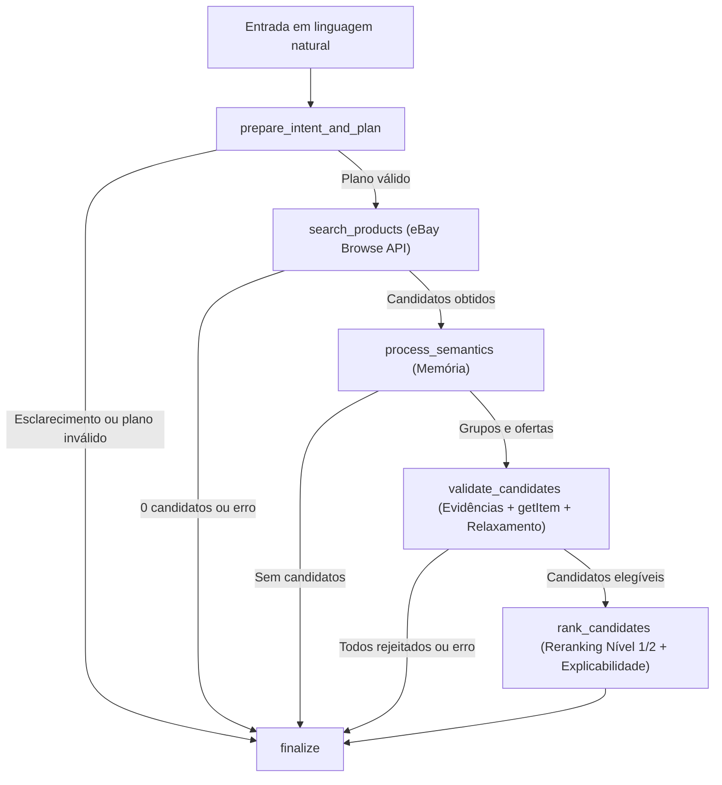

# BUSCAAI — Sistema de Busca Inteligente e Recomendação de Produtos

O **BUSCAAI** é um projeto acadêmico de Engenharia de Software e Inteligência Artificial voltado à busca inteligente e recomendação de produtos em marketplaces, com integração à **eBay Browse API** (`EBAY_US`).

Em vez de depender apenas de correspondência literal por palavras-chave ou ordenação simplista por menor preço, o sistema recebe uma consulta em linguagem natural (PT-BR), extrai a intenção estruturada do usuário, planeja consultas adequadas ao catálogo da eBay, processa similaridade semântica e deduplicação em memória, valida cada candidato por evidências concretas e ordena produtos e ofertas por meio de **reranking multicritério com explicabilidade determinística**.

> **Estado do projeto:** as **Etapas 0 a 10** estão implementadas e validadas offline (`406 passed`), e na **Etapa 11 (Pós-MVP)** foram concluídas a validação real controlada da **eBay Browse API (`EBAY_US`)** nas 4 categorias MVP (`1 OAuth` + `5 Browse` HTTP `200`), a limpeza completa de qualidade (`0` erros de `ruff` e `mypy` em `68` módulos), a auditoria de segurança e o plano operacional de implantação. Permanecem bloqueadas/pendentes antes da produção a avaliação empírica real do `intfloat/multilingual-e5-small` (ausência de pesos locais e dataset amplo) e a captura final das métricas reais do Gemini e fluxo E2E combinado (`RELATORIO_VALIDACAO_POS_MVP.md`).

---

## Principais funcionalidades implementadas (Etapas 0–7)

- **Extração de intenção (`src/userintent/`):** interpretação de solicitações em linguagem natural com Google GenAI SDK (`gemini-3.5-flash-lite` configurável) e schemas Pydantic (`UserIntent`, `PriceConstraint`), reconciliando orçamentos explícitos em `BRL`/`USD`.
- **Construção determinística de consultas (`QueryBuilder`):** tradução controlada de categorias, marcas, especificações e restrições de preço para consultas estruturadas na eBay Browse API (`EBAY_US`), evitando vazamento de termos livres em português para o parâmetro `q`.
- **Integração com eBay Browse API (`EbayLiveBackend` e `EbayOAuthClient`):** consultas a `item_summary/search` e `getItem`, autenticação OAuth 2.0 em memória com renovação antecipada, retries com backoff exponencial (`tenacity`), respeito a `Retry-After` e controle de cota (`QuotaGuard` e `RequestCallBudget` para o limite padrão de `5.000` chamadas/dia).
- **Conversão estimada USD/BRL (`CurrencyConverter`):** cálculos financeiros com `Decimal` e provedor configurável (`FixedEnvExchangeRateProvider`), identificando explicitamente conversões como estimativas.
- **Processamento semântico e deduplicação (`src/buscai/semantic/`):** arquitetura baseada em `intfloat/multilingual-e5-small` (com `SentenceTransformers` / `FastEmbed` opcionais e `DeterministicStubEmbeddingProvider` para testes offline), deduplicação híbrida conservadora que não funde variantes (`mini`, `+`, `Pro/Max/Ultra`, condições distintas) e preservação de todas as ofertas distintas em `DuplicateGroup`.
- **Registro declarativo e validação por evidências (`src/buscai/catalog_profiles.json`, `src/buscai/validation/`):** separação rigorosa entre critérios obrigatórios (*hard constraints*) e preferências flexíveis (*soft preferences*), detecção de contradições internas entre título e atributos, enriquecimento seletivo via `getItem` e relaxamento controlado de preferências sem violar restrições rígidas.
- **Reranking multicritério e explicabilidade (`src/buscai/ranking/`):** ordenação em dois níveis (grupos de produtos e ofertas individuais preservadas), normalização sem coerção de dados ausentes para zero, fator de confiança por cobertura de evidências, penalidade por contradições e explicações determinísticas em PT-BR ancoradas apenas em evidências verificadas.
- **Orquestração com LangGraph (`src/buscai/orchestration/`):** grafo de estados fino (`StateGraph` com `SearchGraphState` e `SearchOrchestrator`) conectando as etapas de ponta a ponta com rotas condicionais de saída antecipada, sem checkpointer e sem tracing externo.
- **API HTTP B2B FastAPI (`src/buscai/api/`):** endpoints `GET /v1/health` (liveness/readiness sem vazar segredos), `POST /v1/search` e **`POST /v1/chat`** (reutilizando `SearchOrchestrator.run()` em threadpool), autenticação por `X-API-Key` com `secrets.compare_digest` e rejeição de placeholders, rate limiting por cliente em memória local ao processo, `X-Request-ID` sanitizado, schemas estritos (`extra="forbid"`) e OpenAPI/Swagger.
- **Chat conversacional multi-turn stateless (`POST /v1/chat` — Etapa 10):** recebe `message` e `conversation_history` (apenas turnos `user` e `assistant`) enviados pelo cliente em cada requisição, sem armazenar sessões ou conversas no servidor, sanitizando eventuais trechos de anúncios anteriores antes de acionar o Gemini e gerando respostas determinísticas em PT-BR ancoradas nas explicações e validações da busca.

---

## Categorias MVP e perfis de utilização

| Categorias MVP (`catalog_profiles.json`) | Perfis de utilização disponíveis |
| :--- | :--- |
| **Notebooks** (`notebook`) | **Best Value** (`best_value`) — equilíbrio entre specs, adequação e custo |
| **Smartphones** (`smartphone`) | **Best Performance** (`best_performance`) — prioriza desempenho e specs comprovadas |
| **Monitores** (`monitor`) | **Lowest Price** (`lowest_price`) — prioriza menor custo sem assumir frete desconhecido |
| **Headphones** (`fone de ouvido`) | **Professional Use** (`professional_use`) — prioriza requisitos técnicos e reputação |
| | **Study** (`study`) — equilibra custo, especificações e portabilidade por categoria |
| | **Everyday Use** (`everyday_use`) — equilíbrio prático entre condição, vendedor e custo |

Os perfis ajustam tanto os critérios obrigatórios/flexíveis na validação (`ValidationPipeline`) quanto os pesos e regras de normalização no reranking (`WeightRegistry`).

---

## Como o sistema funciona

1. **Entrada em linguagem natural:** o usuário informa o produto desejado, orçamento e preferências em PT-BR.
2. **Intenção e plano de busca:** `IntentExtractor` gera `UserIntent` e `QueryBuilder` constrói o `SearchPlan` (ou sinaliza necessidade de esclarecimento).
3. **Consulta ao catálogo:** `SearchBackend` consulta a eBay Browse API respeitando `QuotaGuard` e `RequestCallBudget`.
4. **Processamento semântico e deduplicação:** `SemanticSearchProcessor` calcula similaridade semântica em memória e agrupa ofertas equivalentes preservando variantes e ofertas distintas.
5. **Validação por evidências:** `EvidenceValidator` avalia *hard constraints*, *soft preferences*, orçamento em `Decimal` e contradições entre título e `aspects`.
6. **Enriquecimento seletivo:** `SelectiveEnricher` consulta `getItem` apenas para candidatos elegíveis com lacunas ou ambiguidade crítica.
7. **Relaxamento controlado:** quando há poucos elegíveis, `RelaxationEngine` flexibiliza uma preferência por vez, sem relaxar requisitos obrigatórios.
8. **Reranking multicritério:** `MultiCriteriaReranker` ordena grupos de produtos (Nível 1) e ofertas individuais (Nível 2) conforme perfil e categoria.
9. **Explicação e resposta:** `RankingPipeline` e `SearchOrchestrator` entregam o resultado ordenado com explicações rastreáveis em evidências reais.



---

## Arquitetura e tecnologias

### Stack comprovada (`pyproject.toml`)

| Tecnologia | Papel no projeto | Estado |
| :--- | :--- | :--- |
| **Python (`>=3.11`, validado em `3.14.7`)** | Linguagem principal do backend | Implementado |
| **FastAPI (`>=0.115,<1`) + Uvicorn (`>=0.34,<1`)** | Camada HTTP REST B2B (`GET /v1/health`, `POST /v1/search`) | Implementado (Etapa 8) |
| **Pydantic (`>=2.10,<3`)** | Contratos imutáveis e validação de schemas | Implementado |
| **LangGraph (`>=1.2,<2`)** | Orquestração por `StateGraph` sem persistência | Implementado |
| **eBay Browse API + `httpx` (`>=0.28,<1`)** | Fonte de dados de produção e cliente HTTP | Implementado |
| **Google GenAI SDK (`>=1.0,<2`)** | Extração estruturada de `UserIntent` via Gemini | Implementado |
| **NumPy (`>=2,<3`) e Tenacity (`>=9,<10`)** | Cálculo vetorial em memória e política de retries | Implementado |
| **pytest (`>=8,<10`)** | Suíte automatizada de testes offline | Implementado |
| **Sentence Transformers / FastEmbed** | Execução local opcional do `multilingual-e5-small` | Opcional (`pyproject.toml`) |
| **Streamlit (`>=1.40,<1.67`)** | Protótipo visual legado preservado (`src/buscai/app/`) | Opcional / Legado |

### Estrutura resumida do repositório

```text
BuscaAi/
├── data/
│   ├── eval_ranking_synthetic.jsonl
│   ├── eval_semantic_synthetic.jsonl
│   └── intent_eval_50.jsonl
├── scripts/
│   ├── benchmark_embeddings.py
│   ├── benchmark_ranking.py
│   ├── check_ebay_connection.py
│   └── evaluate_intent.py
├── src/
│   ├── buscai/
│   │   ├── adapters/           # Adaptadores compatíveis com o fluxo legado
│   │   ├── agent/              # Fluxo legado preservado (search_flow.py)
│   │   ├── api/                # Camada HTTP FastAPI, auth X-API-Key e rate limit (Etapa 8)
│   │   ├── app/                # Protótipo Streamlit preservado (D9)
│   │   ├── catalog/            # Erros de provedor e DummyJSON isolado para offline
│   │   ├── observability/      # Logging JSON sanitizado por allowlist
│   │   ├── orchestration/      # Grafo LangGraph (Etapa 7)
│   │   ├── pricing/            # Conversão cambial USD/BRL com Decimal
│   │   ├── ranking/            # Reranking multicritério e explicabilidade (Etapa 6)
│   │   ├── search/             # Backend eBay, OAuth, QuotaGuard e QueryBuilder
│   │   ├── semantic/           # Embeddings, similaridade e deduplicação em memória
│   │   ├── validation/         # Validação por evidências, getItem e relaxamento (Etapa 5)
│   │   ├── catalog_profiles.json
│   │   ├── catalog_registry.py
│   │   └── config.py
│   └── userintent/             # Schema, prompt, extrator Gemini e reconciliação de orçamento
├── tests/                      # Suíte automatizada offline (+1 teste opt-in ebay_live)
├── IMPLEMENTACOES.md           # Registro técnico detalhado por etapa
├── pyproject.toml
└── requirements.txt
```

---

## Privacidade e arquitetura de dados

- **Não persistência de anúncios:** dados retornados pela eBay (`title`, `item_id`, URLs, preços e vendedores) não são salvos em banco de dados, arquivo ou cache persistente.
- **Embeddings efêmeros:** vetores derivados dos anúncios existem apenas em memória durante a requisição e são descartados ao término do processamento.
- **Orquestração stateless:** o `StateGraph` é compilado com `checkpointer=None` e `store=None`, e variáveis de tracing (`LANGSMITH_TRACING`, `LANGCHAIN_TRACING_V2`, etc.) são bloqueadas em runtime.
- **Credenciais e logs:** chaves e segredos são lidos exclusivamente por variáveis de ambiente (`Settings` com `SecretStr`), e logs operacionais registram apenas campos estruturados permitidos por `ALLOWED_LOG_FIELDS`.

---

## Instalação e execução

### 1. Clonar o repositório e criar ambiente virtual

**Windows PowerShell:**
```powershell
git clone <URL_DO_REPOSITORIO>
cd BuscaAi
python -m venv .venv
.\.venv\Scripts\Activate.ps1
```

**Linux / macOS:**
```bash
git clone <URL_DO_REPOSITORIO>
cd BuscaAi
python3 -m venv .venv
source .venv/bin/activate
```

### 2. Instalar dependências

```powershell
python -m pip install -U pip
pip install -e ".[dev]"
```

*(Extras opcionais de embeddings locais, quando necessários em ambiente com suporte: `pip install -e ".[dev,semantic]"` ou `pip install -e ".[dev,semantic-onnx]"`.)*

### 3. Configurar variáveis de ambiente

Copie `.env.example` para `.env` e preencha suas credenciais localmente (nunca versione o arquivo `.env`):

**Windows PowerShell:**
```powershell
Copy-Item .env.example .env
```

**Linux / macOS:**
```bash
cp .env.example .env
```

### 4. Executar a suíte de testes offline, qualidade e benchmarks sintéticos

```powershell
python -m pytest -m "not ebay_live" -q
pytest -m "not ebay_live" -q
.\.venv\Scripts\python.exe -m pytest -p no:cacheprovider -m "not ebay_live" --cov=buscai --cov=userintent --cov-config=pyproject.toml --cov-report=term-missing -q
.\.venv\Scripts\ruff.exe check --no-cache src/buscai/api tests/test_compliance_ebay.py tests/test_resilience.py scripts/benchmark_api_e2e.py
.\.venv\Scripts\mypy.exe --follow-imports=silent src/buscai/api
python scripts/benchmark_ranking.py
python scripts/benchmark_api_e2e.py --iterations 10 --concurrency 4
```

### 5. Executar e operar a API HTTP FastAPI (Etapas 8 e 9)

```powershell
$env:PYTHONPATH = "src"
.\.venv\Scripts\uvicorn.exe buscai.api.app:app --host 127.0.0.1 --port 8000
```

- **Documentação interativa (Swagger UI):** `http://127.0.0.1:8000/docs`
- **Esquema OpenAPI:** `http://127.0.0.1:8000/openapi.json`
- **Variáveis obrigatórias em produção:**
  - `GEMINI_API_KEY` (extração de intenção)
  - `EBAY_CLIENT_ID` e `EBAY_CLIENT_SECRET` (OAuth e Browse API `EBAY_US`)
  - `BUSCAAI_API_KEYS` (lista separada por vírgula; placeholders são rejeitados automaticamente e sem chaves válidas a API falha de forma segura com HTTP `503`)
- **Comportamento de `GET /v1/health` (`liveness` vs `readiness`):**
  - Retorna `liveness: "alive"` e diferencia componentes obrigatórios (`api_auth`, `search_orchestrator`, `embeddings`, `tracing_policy`) de opcionais (`exchange_rate`).
  - Por padrão, `BUSCAAI_EMBEDDING_PRELOAD=false` **não baixa nem pré-carrega pesos automaticamente** na inicialização. Assim, enquanto o modelo obrigatório de embeddings não estiver carregado em memória (ou se credenciais obrigatórias estiverem ausentes), `/v1/health` retorna **HTTP `503`** com `readiness: "not_ready"`.
  - Para pré-carregar pesos já disponíveis localmente no startup, defina `BUSCAAI_EMBEDDING_PRELOAD=true` (com extra `[semantic]` ou `[semantic-onnx]` instalado). Em testes offline/CI, utilize `create_app(..., orchestrator=..., embedding_service=...)` com `DeterministicStubEmbeddingProvider`.
- **Busca autenticada (`POST /v1/search`):** exige header `X-API-Key`, aplica rate limiting por cliente em memória (`BUSCAAI_RATE_LIMIT_PER_MINUTE` / `BUSCAAI_RATE_LIMIT_WINDOW_SECONDS`), propaga/sanitiza `X-Request-ID` e retorna resposta tipada com produtos, ofertas preservadas, scores, validação por evidências e explicações.
- **Chat conversacional stateless (`POST /v1/chat` — Etapa 10):** reutiliza a mesma autenticação `X-API-Key`, rate limiting e `SearchOrchestrator.run()` de ponta a ponta. O cliente envia `conversation_history` (somente `role` `"user"` ou `"assistant"`, sem duplicar a mensagem atual) respeitando os limites configuráveis (`BUSCAAI_CHAT_MAX_HISTORY_MESSAGES=12`, `BUSCAAI_CHAT_MAX_MESSAGE_CHARS=500`, `BUSCAAI_CHAT_MAX_HISTORY_TOTAL_CHARS=4000`), sem sessões ou histórico persistidos no servidor e com remoção automática de eventuais títulos/URLs/IDs/preços de anúncios antes do contexto enviado ao Gemini.
- **Testes manuais no Postman:** consulte [`GUIA_TESTES_POSTMAN_ETAPA_8.md`](GUIA_TESTES_POSTMAN_ETAPA_8.md), [`GUIA_TESTES_POSTMAN_CHAT_ETAPA_10.md`](GUIA_TESTES_POSTMAN_CHAT_ETAPA_10.md) e importe [`postman/BUSCAAI_Etapa_8.postman_collection.json`](postman/BUSCAAI_Etapa_8.postman_collection.json).
- **Integração real controlada (opt-in manual):** para executar contra a eBay Browse API real (`EBAY_US`) sem Gemini e sem download de embeddings (consumo máximo de `1` OAuth + até `8` chamadas Browse nas 4 categorias MVP):
  ```powershell
  $env:RUN_EBAY_INTEGRATION_TESTS = "1"
  .\.venv\Scripts\python.exe -m pytest -p no:cacheprovider -v -m ebay_live tests/integration/test_api_ebay_live.py
  ```

> **Nota sobre rate limiting e cota em múltiplas instâncias:** os contadores do `InMemoryRateLimiter` e do `QuotaGuard` residem exclusivamente na memória do processo local. Em implantações com múltiplos workers/instâncias (`--workers > 1`), cada processo mantém contadores independentes.

---

## Estado atual e roadmap

As **Etapas 0 a 10** estão implementadas e validadas offline (`406 passed, 1 skipped gemini_live, 2 deselected ebay_live`), e a **Etapa 11 (Pós-MVP)** entregou o saneamento integral de lint/tipagem, a validação real controlada contra a eBay (`EBAY_US`) nas 4 categorias MVP, a auditoria de segurança e o plano técnico operacional em [`RELATORIO_VALIDACAO_POS_MVP.md`](RELATORIO_VALIDACAO_POS_MVP.md). Consulte também [`IMPLEMENTACOES.md`](IMPLEMENTACOES.md), [`RELATORIO_TESTES_ETAPA_8.md`](RELATORIO_TESTES_ETAPA_8.md), [`RELATORIO_TESTES_ETAPA_9.md`](RELATORIO_TESTES_ETAPA_9.md) e [`RELATORIO_TESTES_ETAPA_10.md`](RELATORIO_TESTES_ETAPA_10.md).

| Etapa | Escopo planejado | Estado |
| :---: | :--- | :---: |
| **Etapa 8** | API HTTP B2B FastAPI (`GET /v1/health`, `POST /v1/search`), autenticação `X-API-Key` e rate limiting | **Concluída (validada offline)** |
| **Etapa 9** | Conformidade HTTP/eBay, resiliência, benchmark E2E sintético, revisão operacional e qualidade | **Concluída offline (eBay real validada na Etapa 11)** |
| **Etapa 10** | Experiência conversacional multi-turn stateless (`POST /v1/chat`) | **Concluída (validada offline)** |
| **Etapa 11 *(Pós-MVP)*** | Validação empírica (E5, Gemini, eBay, E2E), qualidade total (`ruff`/`mypy`), segurança e plano de implantação | **Parcial (eBay real, T11.5–T11.7 PASSOU; E5 BLOQUEADO; Gemini/E2E pendentes)** |

---

## Limitações conhecidas

- **Validação empírica de embeddings:** o desempenho semântico real de `intfloat/multilingual-e5-small` sobre anúncios reais da eBay e a calibração dos limiares ainda dependem de avaliação empírica com dataset rotulado.
- **Benchmarks atuais:** as métricas disponíveis de embeddings, ranking e HTTP E2E (`scripts/benchmark_api_e2e.py`) vêm de cenários sintéticos offline e não representam latência real de produção.
- **Chamadas reais externas:** os testes `ebay_live` (`tests/integration/test_ebay_live.py` e `tests/integration/test_api_ebay_live.py`) exigem `RUN_EBAY_INTEGRATION_TESTS=1` e não foram executados na suíte offline padrão.
- **Rate limiting e cota locais ao processo:** o controle de taxa e o `QuotaGuard` operam em memória local ao processo (sem Redis/banco de dados).
- **Tipagem estrita legada (`mypy`):** `src/buscai/api/` possui 0 erros com `--follow-imports=silent`, enquanto 5 arquivos das Etapas 3–7 ainda possuem apontamentos pontuais de `mypy` preservados para não alterar contratos anteriores.
